# 평가 지표 해설 (산출식 + 그래프)

> 매칭 방식 업데이트: 현재 분석은 극값 기준점 + 구간 DTW를 사용합니다. 아래 기존 DTW 설명과 그림은 이전 방식입니다. 새 매칭과 파일 형식은 [README](../README.md#극값-기준-매칭--구간-dtw)를 참고하세요.

이 프로그램이 계산하는 **모든 평가 지표**의 정의, 산출식, 읽는 법을 정리했습니다.
수식은 그림(PNG)으로 조판했고, 지표마다 실제 실행 기록으로 만든 설명 그래프를 붙였습니다.
(마크다운 뷰어의 수식 지원 여부와 상관없이 그대로 보입니다. 그림을 다시 만드는 방법은 맨 아래에 있습니다.)

- 대상 코드: [`analysis.py`](../src/rb_servo_gui/analysis.py) (`analyze`, `motion_window`, `ordered_match`, `refine_pairs`, `coverage`, `velocity`, `smoothness`)
- 설정값(합격선): [`settings.py`](../src/rb_servo_gui/settings.py)
- 결과 파일의 이름: 실행 폴더의 `compare_*.json`(지표와 판정), `summary.csv`(실행마다 한 줄)

## 0. 표기와 예제 실행

| 기호 | 뜻 |
|---|---|
| `q_i` | 모션 구간에서 측정한 6관절 각도 벡터 (i = 1..N), 단위 deg |
| `r_k` | 원본(기준) 궤적의 점, `r_N` 은 마지막 점, `r_0` 은 첫 점 |
| `p_i` | 측정 샘플 `i` 와 DTW 로 짝지은 원본 경로 위의 점 (선분 위의 연속 위치) |
| `p_i` (진행도) | 그 점이 원본 경로 길이의 몇 % 지점인지 (0~1). 문맥으로 구분 |
| `L` | 원본 경로 전체 길이 (6관절 공간의 L2 호길이, deg) |
| `t_cmd` | 추종 지령(jb2 는 `move_jb2_run`, servo 는 첫 `move_servo_j`)을 보낸 시각 |

설명 그래프는 아래 두 실행으로 그렸습니다.

| 용도 | 실행 | 내용 |
|---|---|---|
| 주 예제 | `20261008_162955_servo_step10` | `waypoints_robot2.csv`, servo, 시뮬레이션, 지령 간격 0.2 s |
| 리스트 구성 시간 | `20261008_165824_jb2_step10` | jb2 (리스트 구성 시간 `t_build` 가 있는 실행) |
| 종료 오버슈트 | `20261008_132802_servo_step10` | 마지막 점을 반복하지 않아 종료 오차가 큰 실행 |

## 1. 지표 한눈에

| 분류 | 지표 | 기호 | 단위 | 판정에 사용 | 합격선 (기본값) |
|---|---|---|---|---|---|
| 시간 | 추종 시간 | `T_track` | s | 아니오 | - |
| 시간 | 지령→모션 시작 | `t_latency` | s | 아니오 | - |
| 시간 | 지령→완료 | `t_total` | s | 아니오 | - |
| 시간 | 리스트 구성 시간 (jb2) | `t_build` | s | 아니오 | - |
| 시간 | 원본 대비 배율 | `ratio` | - | 아니오 | - |
| 궤적 추종 오차 | 평균, rms, p95, 최대 | `d_mean`, `d_rms`, `d_p95`, `d_max` | deg | p95, 최대 | p95 ≤ 1.0, 최대 ≤ 2.0 |
| 궤적 추종 오차 | 각도 오차 RMSE (매칭 후 / 전) | `RMSE_after`, `RMSE_before` | deg | 아니오 | - |
| 커버리지 | 평균, p95, 최대 | `c_mean`, `c_p95`, `c_max` | deg | 최대 | ≤ 2.0 |
| 진행도 | 경로 진행도 | `progress` | 0~1 | 예 | ≥ 0.99 |
| 샘플 간 이동 | 최대 이동 | `Δ_max` | deg | 예 | ≤ 5.0 |
| 시작/종료 | 시작 각 오차, 종료 각 오차 | `e_start`, `e_end` | deg | 예 (둘 중 큰 값) | ≤ 0.5 |
| 타이밍 | 지연 범위, 늦음/빠름 비율 | `Δτ`, `late`, `early` | 비율 | 아니오 (참고) | 표시 기준 0.03 |
| 속도 | 관절 최대 속도, 속력 최대/평균 | `v_max,joint`, `v_max,norm`, `v_mean,norm` | deg/s | 아니오 | - |
| 링크 표면 (URDF 지정 시) | 최악 점 변위, Chamfer, Hausdorff | `D`, `CD`, `HD` | mm | 아니오 (참고) | - |
| 매끄러움 | 속도 리플 | `R` | 비율 | 예 | ≤ 0.15 |
| 매끄러움 | 횡방향 흔들림 | `W` | deg | 예 | ≤ 0.30 |
| 매끄러움 | 정체 비율 | `S` | 비율 | 예 | ≤ 0.02 |
| 매끄러움 | 거친 구간 비율, 최대 점수 | `rough_ratio`, `rough_score_max` | 비율, - | 아니오 (참고) | 점수 1 = 기준 |

판정은 **9개 항목**(표에서 "예"인 것: 추종 오차 p95, 최대, 커버리지, 진행도, 샘플 간 이동, 시작/종료 오차, 리플, 흔들림, 정체)이 모두 통과해야 PASS 입니다.
합격선은 근거 없이 잡은 **초기값**이라 응용에 맞게 조정해야 합니다.

## 2. 처리 흐름

```
측정 기록 (50 Hz) ─► 추종 구간 찾기 (3장) ─► DTW 순서 보존 매칭 (4장) ─┬─► 궤적 추종 오차 d_i, 쌍 오차 e_i
원본 궤적 (traj_ref.csv)                                              ├─► 커버리지, 진행도, 샘플 간 이동 (5~6장)
                                                                      ├─► 타이밍 지연 (8장)
                                                                      └─► 매끄러움 R, W, S (10장)
측정 기록 ─► 속도 (9장),  마지막/직전 안정 구간 ─► 시작/종료 각 오차 (7장)
```

---

## 3. 시간 지표 (추종 구간과 추종 시간)

**추종 구간**은 모션이 실제로 일어난 부분입니다. 시작과 끝을 다음과 같이 정합니다.

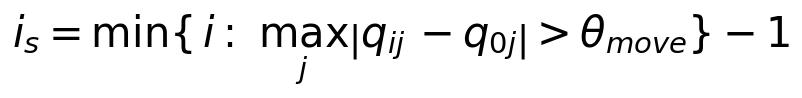

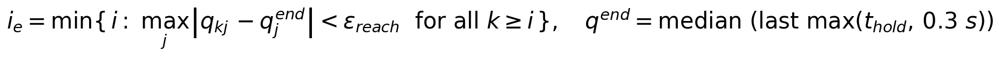

- 시작: 시작 자세 `q_0` 에서 `θ_move`(기본 0.2°) 넘게 벗어나기 **직전** 샘플.
- 종료: 이후 기록 끝까지 **로봇이 멈춘 자세**(마지막 `max(t_hold, 0.3)` 초의 중앙값 `q^end`)의 `ε_reach`(기본 0.5°) 이내에 머무는 첫 샘플.
  목표가 아니라 **로봇이 실제로 멈춘 자세**를 기준으로 하므로, 종료 오차가 커도(서보 오버슈트 등) 추종 시간이 기록 끝까지 늘어나지 않습니다.

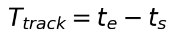

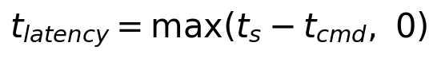

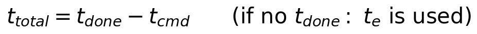

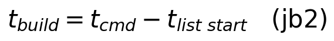

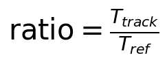

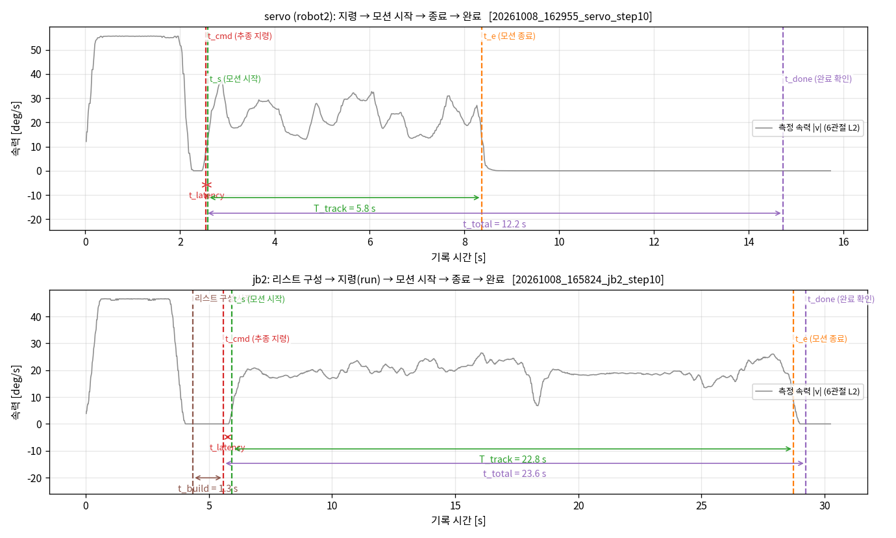

| 지표 | 읽는 법 |
|---|---|
| `T_track` | 모션이 일어난 시간. 예제 servo 는 5.78 s (원본 5.78 s, 배율 1.0), jb2 는 22.80 s (원본 14.67 s) |
| `t_latency` | 지령을 보낸 뒤 움직이기까지의 지연. 예제 servo 0.04 s, jb2 0.35 s. 음수가 되지 않게 0 으로 자릅니다 |
| `t_total` | 지령부터 **완료를 확인한** 시각까지. 모션이 끝난 뒤 도달을 확인하는 시간과, servo 는 마지막 점을 반복 전송하는 시간(`final_hold` × 명령 주기)이 포함됩니다. 예제 servo 는 `final_hold = 30` 이라 12.18 s 입니다 |
| `t_build` | jb2 에서 `move_jb2_add` 로 포인트를 쌓는 데 걸린 시간. 예제 1.25 s |
| `ratio` | `T_track / T_ref`. 1 보다 크면 원본보다 느리게 실행됨 (예제 jb2 는 약 1.55) |

---

## 4. 궤적 추종 오차 (DTW 매칭쌍 기준)

측정과 원본을 같은 시각끼리 비교하면 **시간이 어긋난 것까지 오차**가 됩니다. 그래서 먼저 측정 샘플마다 원본 경로 위의 짝 `p_i` 를 정합니다.

- 짝을 정하는 방법은 **순서를 보존하는 DTW**입니다 (측정 샘플이 시간 순서로 진행하면 짝도 같은 순서로 진행).
  다른 시각에 우연히 같은 각도를 지나가더라도 거기에 짝지어지지 않고, 시간 지연이나 속도 차이는 허용합니다.
- DTW 가 정한 원본 정점의 양옆 선분 위에서 가장 가까운 점을 짝으로 삼아 정점 단위 양자화 오차를 없앱니다.

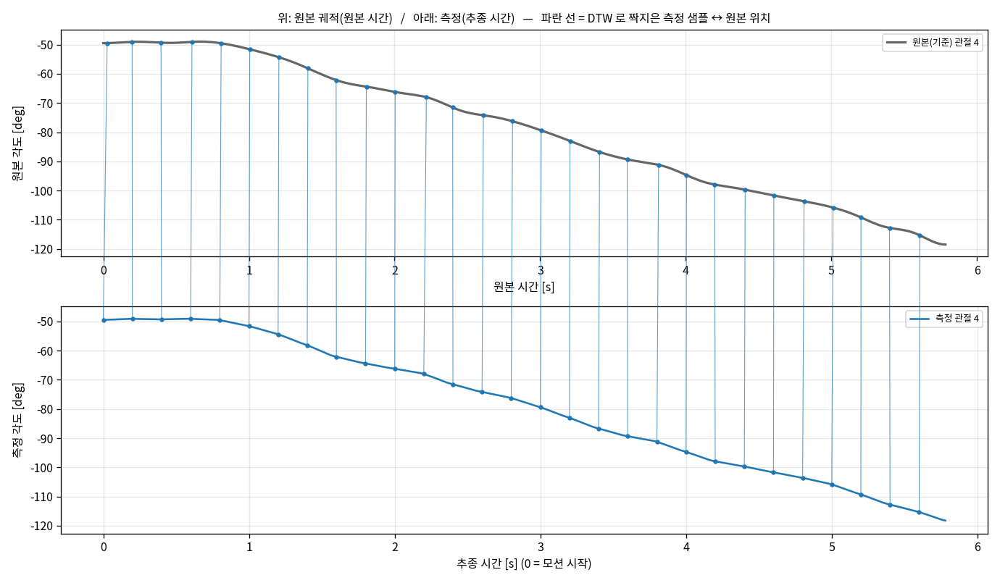

짝이 정해지면 오차 벡터와 크기를 다음과 같이 정의합니다.

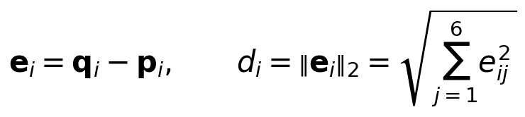

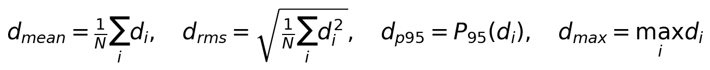

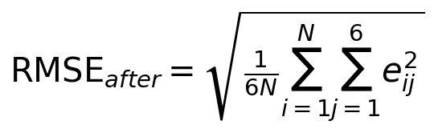

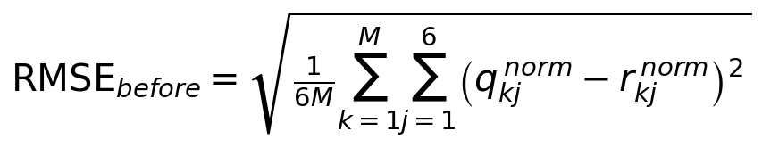

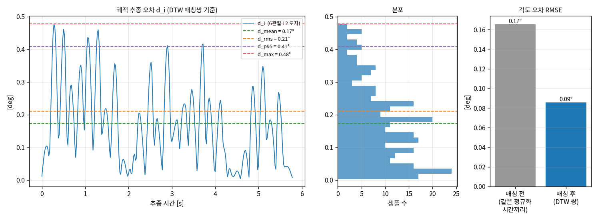

- **판정에는 `d_p95` 와 `d_max` 를 씁니다.** 예제 servo: `d_mean` 0.17°, `d_rms` 0.21°, `d_p95` 0.41°, `d_max` 0.48°.
- 오차 `e_i` 는 경로에 **수직인 방향**입니다(실기록에서 경로 접선과의 |cos| 중앙값이 0.000). 경로 위에서 앞서거나 뒤처진 것은 DTW 가 흡수합니다.
- `RMSE_before` 는 시작과 종료만 맞춘 정규화 시간(M = 500점)에서 **같은 시각끼리** 비교한 값, `RMSE_after` 는 DTW 쌍 기준입니다. 예제는 0.17° 에서 0.09° 로 줄었습니다.
  두 값의 차이가 클수록 오차의 상당 부분이 경로 이탈이 아니라 시간 어긋남이었다는 뜻입니다.

---

## 5. 커버리지 (건너뛴 구간 검출)

`d_i` 는 "측정 → 원본" 방향의 거리라서, 로봇이 경로의 일부를 **건너뛰어도** 작게 나올 수 있습니다. 반대로 "원본의 각 점 → 측정 경로" 거리를 재면 건너뛴 구간이 드러납니다.

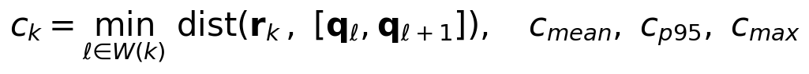

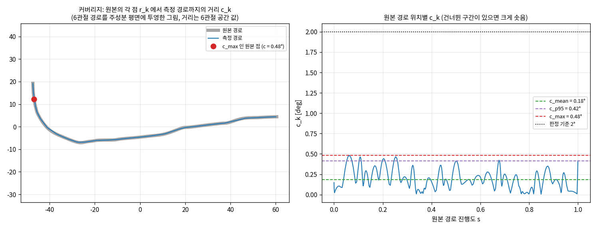

- `W(k)` 는 원본 점 `r_k` 에 DTW 로 짝지어진 측정 구간 근처의 선분들입니다. **전체 측정 경로에서 가장 가까운 점을 찾지 않는** 이유는, 다른 시각에 같은 각도를 지나간 우연한 일치를 인정하지 않기 위해서입니다.
- 한 번도 가지 않은 구간이 있으면 그 구간의 `c_k` 가 크게 솟고 `c_max` 가 커집니다. 예제는 `c_mean` 0.18°, `c_p95` 0.42°, `c_max` 0.48° 입니다.

---

## 6. 경로 진행도와 샘플 간 이동

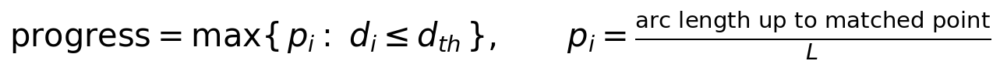

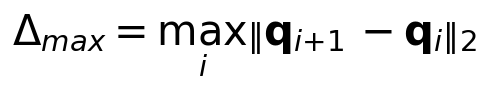

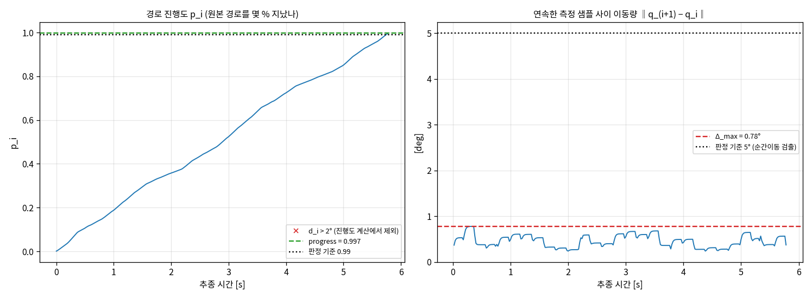

- **진행도**: 원본 경로를 어디까지 갔는지. 경로 편차가 `d_th`(= 판정 기준 2°)를 넘는 샘플은 짝이 의심스러워 **계산에서 제외**합니다(왼쪽 그림의 ×). 예제 0.997.
- **샘플 간 이동**: 연속한 두 측정 샘플 사이 이동량. 갑자기 큰 값이 나오면 순간이동이나 건너뜀입니다. 예제 최대 0.78°, 기준 5°.

---

## 7. 시작/종료 각 오차

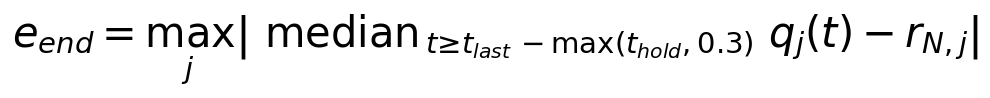

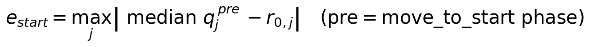

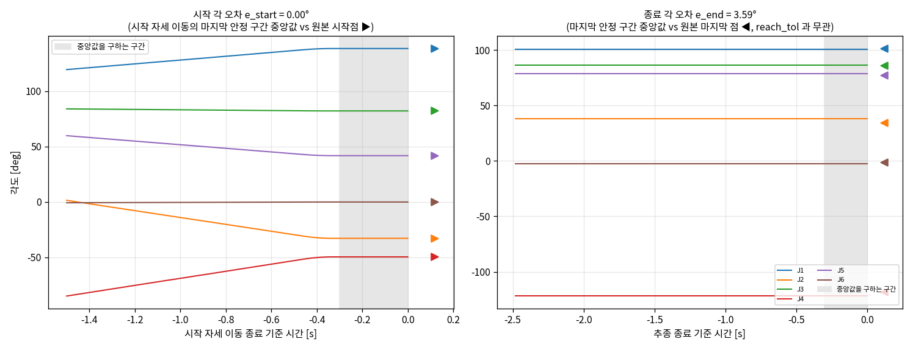

- **종료 각 오차**는 추종 구간 끝의 **마지막 안정 구간 중앙값**과 원본 마지막 점의 관절별 차이 중 최댓값입니다. 모션 종료 판정(`ε_reach`)과는 **무관하게** 따로 잽니다.
- **시작 각 오차**는 추종 직전 단계(시작 자세 이동)의 마지막 안정 구간으로 잽니다. 추종 구간의 첫 샘플은 이미 움직이기 시작한 뒤일 수 있기 때문입니다.
- 위 그림은 마지막 점을 반복하지 않았던 실행(`132802`)이라 종료 오차가 3.59° 로 큽니다. 같은 궤적을 `final_hold` 로 돌린 예제 실행은 0.00° 였습니다.
  (servo 는 마지막 지령 뒤에 마지막 속도 × `t2` 만큼 더 나아가 멈추는 것이 관측되었습니다. 이 동작은 공식 문서에 없습니다.)
- 판정은 `max(e_start, e_end) ≤ 0.5°` 입니다.

---

## 8. 타이밍 지연 (참고 지표, 판정에 쓰지 않음)

같은 **경로 진행도**에 도달한 (정규화) 시간이 원본보다 늦었는지 빨랐는지를 봅니다.

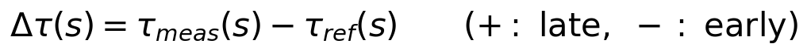

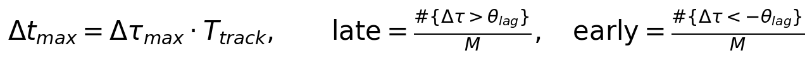

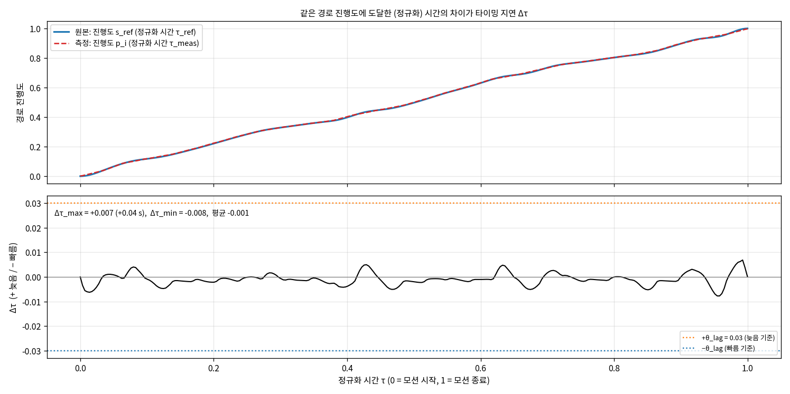

- 정규화 시간은 모션 시작을 0, 종료를 1 로 한 시간입니다. `+` 는 측정이 **늦음**, `−` 는 **빠름**입니다. `Δt_max` 는 비율을 추종 시간으로 환산한 초 값입니다.
- 예제 servo: `Δτ` 범위 −0.008 ~ +0.007, 평균 −0.001 (최대 +0.04 s). 거의 일치합니다.
- 실행 시간이 크게 다른 jb2 에서는 비율로 보는 것이 의미가 있습니다(원본 14.7 s 를 22.8 s 에 걸쳐 실행해도 진행 방식이 같으면 `Δτ` 가 작게 나옵니다).
- 지연을 합격/불합격으로 쓰지 않는 이유는, 시간이 어긋나도 경로를 정확히 따라갔는지를 먼저 평가하려는 것입니다.

---

## 9. 추종 속도

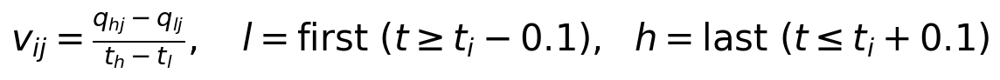

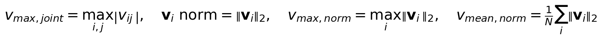

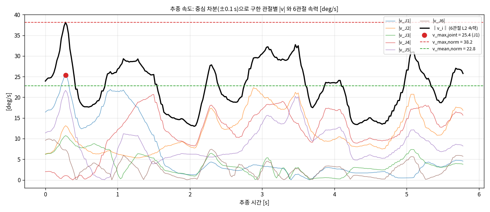

- 속도는 측정 각도를 `t ± 0.1 s` 구간의 양 끝으로 **중심 차분**해 구합니다 (샘플 시각 지터에 강하게 하려는 것).
  이 차분은 저역통과(sinc) 특성이라 5 Hz 이상의 빠른 요동은 거의 걸러집니다.
- 예제 servo: 관절 최대 25.4 deg/s, 6관절 속력 최대 38.2 / 평균 22.8 deg/s.
- 결과 화면과 저장 그래프에서는 방향이 아닌 크기를 보려고 **절대값**으로 그립니다. `velocity_*.csv` 는 부호 있는 값입니다.

---

## 10. 매끄러움 (속도 리플, 횡방향 흔들림, 정체 비율)

**경로 자체가 꺾였거나 매끄럽지 않은 것은 감점하지 않도록**, 경로 모양과 무관한 양만 봅니다. jerk 는 측정 노이즈에 지나치게 민감해서 쓰지 않습니다.

### 10.1 공통 준비: 경로를 따라간 속력과 추세

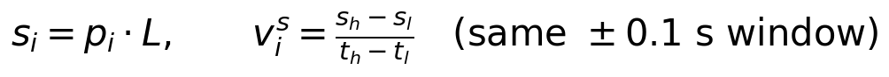

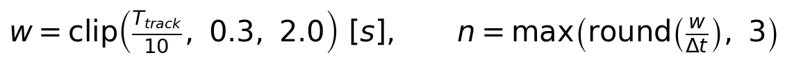

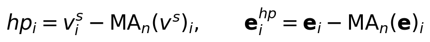

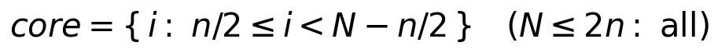

- `v^s_i` 는 **경로 위에서 간 거리(호길이)의 변화율**입니다. 경로가 꺾여도 이 값은 그대로라서 경로 모양의 영향을 받지 않습니다. 진행도가 줄지 않게 처리하므로 `v^s ≥ 0` 입니다.
- `MA_n` 은 길이 `n` 샘플의 중심 이동평균입니다(양 끝은 끝값으로 연장). 창 `w` 는 추종 시간의 1/10 이고 0.3~2.0 s 로 제한됩니다. 예제는 `w` = 0.58 s, `n` = 29.
- **고주파 = 원래 값 − 추세**. 추세보다 느린 변화는 "정상적인 가감속"으로 보고 리플에 넣지 않습니다.
- 양 끝 `n/2` 샘플(`core` 밖)은 이동평균의 가장자리 효과 때문에 요약 값에서 제외합니다.

### 10.2 속도 리플 `R` 과 정체 비율 `S`

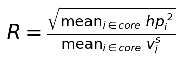

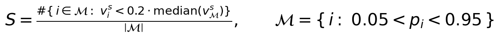

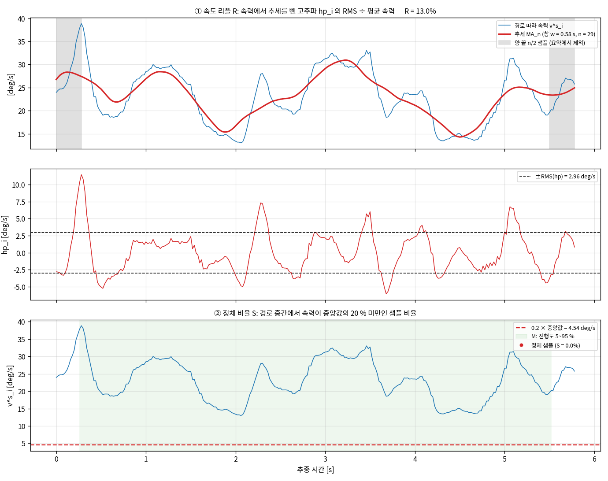

- `R` 은 속력이 추세 둘레에서 얼마나 요동하는지를 평균 속력에 대한 **비율**로 나타냅니다. `R = 15 %` 는 평균 속력의 15 % 정도 요동한다는 뜻입니다. 예제 `R` = 13.0 %.
- `S` 는 경로 중간(진행도 5~95 %, 시작과 끝의 정상적인 가감속 제외)에서 속력이 **중앙값의 20 % 미만**으로 떨어진 샘플의 비율입니다. 멈칫거림을 잡습니다. 예제 `S` = 0 %.

### 10.3 횡방향 흔들림 `W`

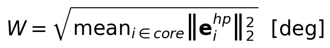

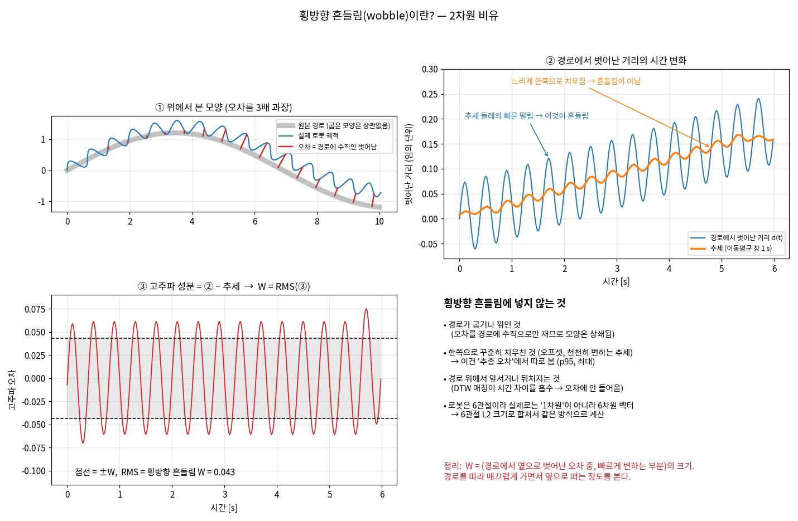

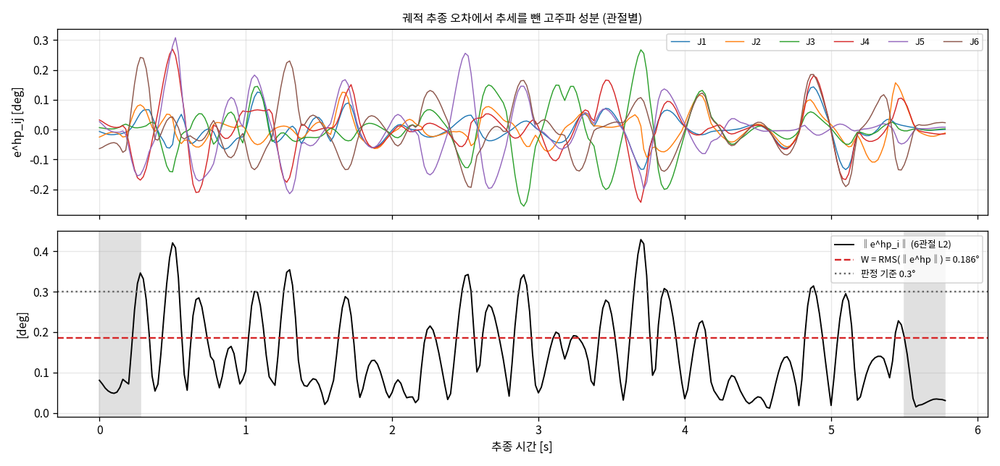

- "횡방향"은 **경로에 수직인 방향**입니다(6관절 공간에서의 방향).
- 경로에서 옆으로 벗어난 정도를 느린 변화(추세)와 빠른 변화(떨림)로 나눠, 빠른 변화의 크기가 `W` 입니다. 한쪽으로 꾸준히 치우친 오프셋은 추세라서 `W` 가 아니라 4장의 추종 오차로 잡힙니다.
- 읽는 법: `W = 0.2°` 이면 경로 옆 벗어남이 추세 둘레에서 RMS 0.2° 정도 떤다는 뜻입니다. 예제 `W` = 0.186°.

### 10.4 국소 거칠기 점수와 거친 구간

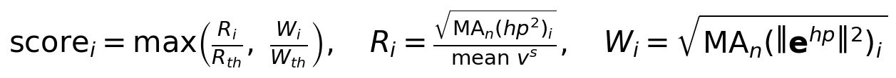

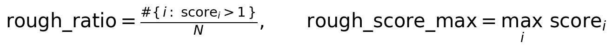

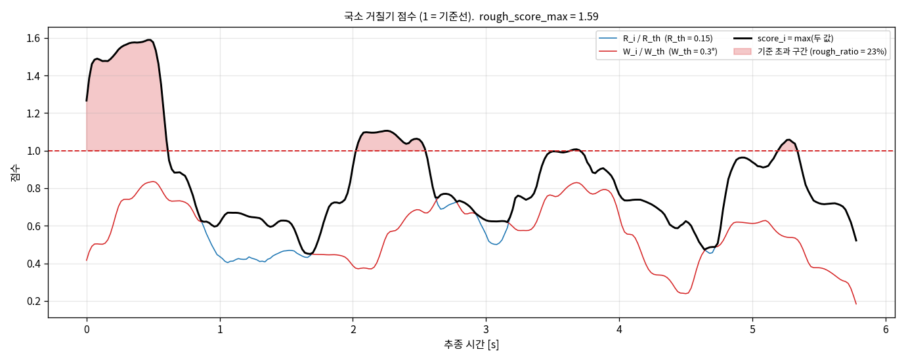

- 위 지표를 **샘플마다 이동 창 RMS** 로 바꿔서 경로의 어디가 거친지 봅니다. 점수 1 이 기준선이고, 결과 표의 "거친구간" 열과 `smooth_map_*.png` 의 색이 이 값입니다.
- 예제는 거친 구간 비율 23.4 %, 최대 점수 1.59 입니다. 판정에는 쓰지 않는 참고 정보입니다.

---

## 11. 링크 표면 오차 (URDF 지정 시, 참고 지표)

관절각 오차는 **로봇 형상에서 표면이 실제로 얼마나 떨어지는지(mm)** 로 바꿔 봐야 의미가 분명합니다. 같은 1° 오차도 어깨 관절이면 20 mm 가까이, 손목 끝 관절이면 1 mm 미만입니다.

**방법.** URDF 의 링크 메시(충돌 STL)에서 표면 점을 링크당 `surface_points` 개(기본 600) 뽑습니다. 추종 구간에서 매칭쌍 `surface_samples` 개(기본 200, 균등 추출)를 골라, 각 쌍마다

- 측정 자세 `q_i` 와 DTW 로 짝지은 원본 자세 `p_i` 를 **각각 FK 로 배치**해 두 표면 점집합 `A`(측정), `B`(원본)를 만들고 비교합니다.
- 전체 로봇 지표(Chamfer, Hausdorff, 대응점 변위의 전체 최대)는 **팔 관절과 함께 움직이는 링크의 점집합**으로 계산하고, 링크별 최대 변위도 구합니다. 레일, 캐리지 같은 박스 구조물과 팔 베이스(link0)는 팔 오차로 움직이지 않아서, 넣으면 평균을 희석하므로 제외합니다.
- 외부축 등 앞쪽 관절은 0 으로 두는데, 두 자세에 똑같이 적용되므로 상대 차이에는 영향이 없습니다.
- 길이는 URDF 의 m 를 mm 로 환산해 보고합니다.

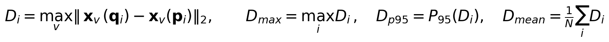

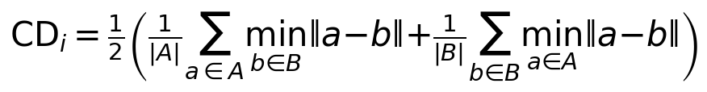

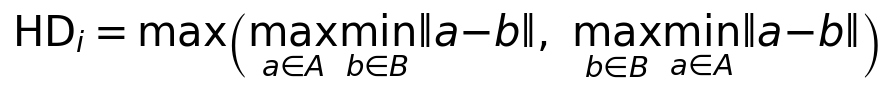

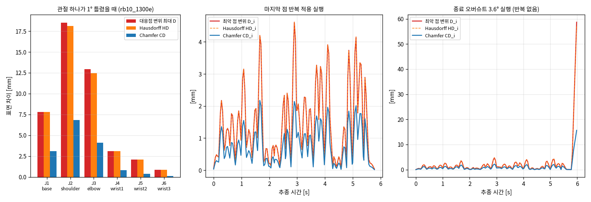

**셋 중 무엇을 봐야 하나**

| 지표 | 무엇을 재나 | 장점 | 주의 |
|---|---|---|---|
| 대응점 변위 `D` | **같은 메시 점**이 두 자세에서 떨어진 거리의 최댓값 | 최악의 점을 정확히 보여줌. 링크별 최대도 구함 | 대응점이 있어야 함 (여기서는 같은 URDF 를 쓰므로 항상 있음) |
| Hausdorff `HD` | 두 표면 사이 최근접 거리의 **최댓값** | 대응점이 필요 없음, 최악의 경우를 보여줌 | 표면이 자기 위를 미끄러지면 `D` 보다 작아질 수 있음 |
| Chamfer `CD` | 두 표면 사이 최근접 거리의 **평균** | 전체적인 표면 일치 정도 | **최악 위치를 크게 낮춰 봄** |

- 이 문서의 예시에서 `D` 와 `HD` 는 거의 같고 `CD` 는 훨씬 작습니다. 어깨 관절 1° 오차는 `D` 18.5 mm, `HD` 18.1 mm, `CD` 6.8 mm 입니다.
  종료 오버슈트가 3.6° 인 실행은 `D` 최대 58.7 mm 인데 `CD` 최대는 15.7 mm 라서, **`CD` 만 보면 최악 위치의 오차를 약 3.7배 낮게 평가합니다.**
- 그래서 **주 지표는 `D`(최악 점 변위)** 이고 Chamfer, Hausdorff 는 함께 보고합니다. 충돌이나 간극 관점에서는 평균이 아닌 최악이 중요합니다.
- 결과는 시간에 대해 `D_i` 의 최대, p95, 평균, Chamfer 의 최대와 평균, Hausdorff 최대, 링크별 최대 변위, 최악 링크로 정리합니다.
  예제 servo(마지막 점 반복 적용)는 `D` 최대 4.6 mm, p95 3.6 mm, 평균 1.5 mm, Chamfer 최대 2.19 mm 였습니다.

**계산이 맞는지 확인한 것.** 한 관절만 1° 돌렸을 때의 `D` 가 기하학적 예측값(회전축에서 가장 먼 점까지의 거리 × 각도, `2·r·sin(θ/2)`)과 6관절 모두 소수 둘째 자리까지 일치했습니다 (rb10_1300e, robot1 시작 자세).

**화면으로 보기.** 결과 탭의 **★ 메시 차이** 항목에서, 시간 그래프를 클릭해 고른 시점의 두 자세를 메시로 겹쳐 볼 수 있습니다(색 = 같은 점의 실제 변위, 형상은 실제 크기 ×1). 자세한 사용법은 [README](../README.md) 참고.

**쓰는 법.** 설정의 "URDF" 칸에 URDF 파일을 지정합니다(비우면 계산하지 않음). 결과는 `compare_*.json` 의 `surf_*` 항목과 `surface_*.csv`(시간별 `D`, `CD`, `HD`), 결과 탭의 상세 패널에 나옵니다.
링크별 최대 변위는 JSON 의 `surface_links_max_mm` 에 있습니다. 합격선은 정하지 않았고 참고용입니다.

**모델에 따른 차이.** 같은 측정값이라도 팔이 클수록 mm 값이 큽니다. 사용자의 RT 궤적(`waypoints_sample`) 실행에서 `rb20_1900es_RT` 는 `rb10_1300e` 보다 약 1.6배 큰 값을 줍니다(REAL servo 실행: 대응점 변위 최대 15.4 mm 대 9.5 mm). 어느 URDF 를 쓰는지가 결과에 직접 영향을 줍니다.

**한계**

- **URDF 가 실제 로봇과 같아야** 합니다. 제어기 설정(`controller.cfg`)에는 두 로봇이 모두 rb10_1300e 이고, `rb10_1300e.urdf`, `rb10_1300e_RT.urdf`, `rb10_1300e_DDA.urdf` 의 팔 기구학은 같습니다(링크 원점 간 거리 차이 0.000 mm). `rb20_1900es_RT.urdf` 는 다른 팔입니다(차이 약 777 mm). 관절 영점, 부호, 링크 치수가 다르면 값이 달라집니다. 이 도구는 이를 확인하지 못합니다 (`reqdata` 의 `tcp_pos` 와 FK 를 비교하면 확인할 수 있지만 아직 하지 않았습니다).
- 메시는 충돌 STL 을 샘플링한 점입니다. 점이 성기면 Chamfer, Hausdorff 가 조금 흔들립니다. `D` 는 같은 점끼리 비교하므로 이 영향이 작습니다.
- 도구와 케이블, 가공물 등 URDF 에 없는 형상은 포함되지 않습니다.

## 12. 판정 요약

| 번호 | 판정 항목 | 조건 | 설정키 |
|---|---|---|---|
| 1 | 궤적 추종 오차 p95 | `d_p95 ≤ 1.0` deg | `th_path_p95` |
| 2 | 궤적 추종 오차 최대 | `d_max ≤ 2.0` deg | `th_path_max` |
| 3 | 커버리지 최대 | `c_max ≤ 2.0` deg | `th_cover` |
| 4 | 경로 진행도 | `progress ≥ 0.99` | `th_progress` |
| 5 | 샘플 간 이동 | `Δ_max ≤ 5.0` deg | `th_step` |
| 6 | 속도 리플 | `R ≤ 0.15` | `th_ripple` |
| 7 | 횡방향 흔들림 | `W ≤ 0.30` deg | `th_wobble` |
| 8 | 정체 비율 | `S ≤ 0.02` | `th_stall` |
| 9 | 시작/종료 각 오차 | `max(e_start, e_end) ≤ 0.5` deg | `th_end` |

그 밖의 설정: `th_lag`(타이밍 지연 표시 기준, 판정 미사용), `reach_tol`(모션 종료 판정 허용 오차), `reach_hold`, `move_thr`(모션 시작 판정).

## 13. 한계와 주의

- **창이 추종 시간에 비례**합니다(매끄러움). 추종 시간이 크게 다른 실행끼리 `R`, `W` 를 직접 비교하기는 어렵습니다.
- 속력은 DTW 로 구한 진행도의 미분이라 **매칭 오차가 리플에 섞입니다**. 실행 간 비교용으로는 괜찮지만 절대값에는 이 오차가 포함됩니다.
- 이상적으로 추종해도 `R` 은 0 이 아닙니다(정상적인 가감속이 창보다 빨리 변할 때, 합성 데이터에서 약 3~6 %).
- 진행도는 감소하지 않게 처리해서 **되돌아가는 움직임**은 매끄러움에서 잡히지 않습니다. 그런 경우는 추종 오차나 진행도에서 드러납니다.
- 시뮬레이션에서는 측정각으로 `jnt_ref` 를 쓰므로(`jnt_ang` 는 0 으로 고정됨) 이 값이 실제 하드웨어를 반영하는지는 확인되지 않았습니다.
- 합격선은 실제 허용 수준에서 정한 값이 아닙니다.

## 14. 그림과 수식 다시 만들기

```
cd rb_servo_gui
PYTHONPATH=src python docs/make_metric_figures.py \
    --servo   <servo 실행 폴더> \
    --jb2     <jb2 실행 폴더> \
    --overshoot <마지막 점 반복 없이 종료 오버슈트가 있던 servo 실행 폴더>
```

수식은 `make_metric_figures.py` 안의 `FORMULAS` 사전에 있고, 설명 그래프는 현재 `analysis.py` 의 함수로 다시 계산해서 그립니다.
