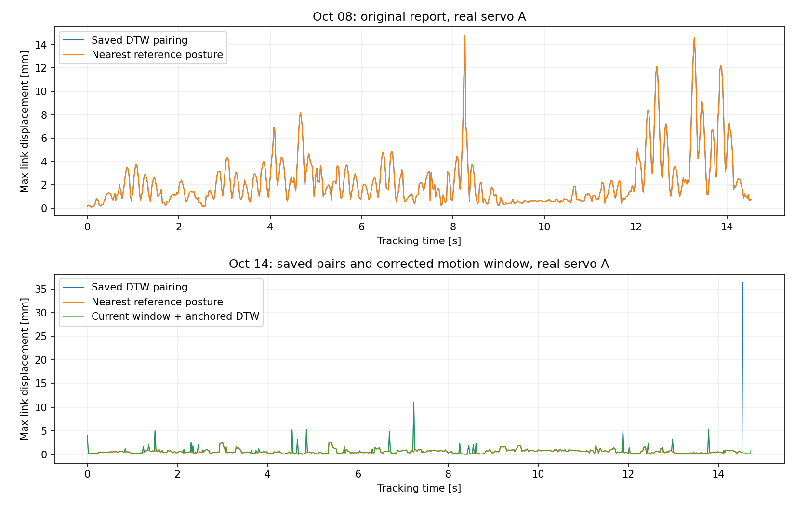

# 링크 변위 최대값의 DTW 의존성 검증

검증일: 2026-10-20. 원본 실험 파일과 기존 보고서를 변경하지 않고 별도로 재계산했다.

## 결론

- **10/08 보고서의 24회:** 최근접 원본 자세로 바꿔도 최대 변위 변화가 0.003mm 미만. 보고서의 8~16mm를 DTW 대응 때문에 커진 값으로 볼 근거는 없다.
- **10/14 실기 3회:** 현재 저장된 매칭쌍의 최대는 마지막 샘플을 원본 끝점에 고정한 영향이 크다. 종료 구간을 현재 코드로 연장하면 최대가 감소한다. 이후 남은 최대는 모두 중간 극값 앵커에서 발생하며, 그 순간 최근접 자세로 바꾸면 다시 크게 감소한다.
- 10/14 세 실행의 traj_ref 관절열은 10/08 A·B·C와 동일하다(허용차 1e-7 rad). 별도 단순 관절 실험과 혼동하지 않았다.

## 1. 비교 방법

동일 측정 자세와 동일 URDF(rb20_1900es_RT), 충돌 메시 표면 600점/링크(seed=0)를 사용했다. 시간 일부 샘플링 없이 저장 매칭쌍 전체를 계산했다. 같은 메시 점의 위치 차이를 구하고 움직이는 링크 전체의 최댓값을 사용했다.

① 저장 DTW 원본 자세와 비교 ② 같은 측정점에서 원본 6관절 꺾은선의 최근접 자세와 비교. 두 경우를 바꾸는 것은 원본 대응 자세뿐이다. 최근접은 **관절 L2 거리** 기준이며 공간 변위를 최소화한 해가 아니다. 순서/시간을 보장하지 않으므로 이를 정답 추종 오차 또는 시간 추종 성능으로 해석하지 않는다.

## 2. 10/08 보고서 대표 사례

실기 servo A (20261008_164846): 저장 DTW 최대 14.782mm → 같은 순간 최근접 자세 기준 14.781mm. 해당 최대는 대응 자세를 바꾸어도 남는다. 전체 24회에서도 동일한 경향이다. 저장 보고서 데이터셋과 현재 실행 폴더의 pairs CSV가 모두 같은 내용임을 확인했다.

## 3. 10/14 실기 A·B·C

아래 “저장 최대”는 현재 실행 폴더의 pairs/surface CSV 값이다. 보고서 작성 당시 수치와 재분석 시점이 다르므로 구별한다.

| 궤적 | 저장 최대 [mm] | 같은 순간 최근접 [mm] | 종료 구간 보정 후 최대 [mm] | 보정 후 최대 순간 최근접 [mm] |
|---|---:|---:|---:|---:|
| A | 36.326 | 0.411 | 11.073 | 0.381 |
| B | 23.034 | 0.205 | 6.332 | 0.622 |
| C | 25.787 | 0.173 | 7.513 | 0.757 |

**종료점 문제:** 저장된 마지막 분석 시각은 A/B/C 각각 14.54 / 8.3399 / 7.02초. 이때 원본 최종 자세와의 관절 L2 오차는 1.66 / 1.30 / 1.33°지만, 같은 측정점에서 경로까지의 거리는 0.016 / 0.014 / 0.015°다. 아직 경로 위에서 움직이는 자세를 최종 자세에 연결한 것이다. 원래 안정 종료 오차는 약 0.001°로 별도 측정돼 있다.

현재 motion_window 함수로 다시 구한 끝 시각은 14.7201 / 8.52 / 7.18초. 전송·측정 원본은 그대로 두고 이 구간에 현재 극값 앵커 DTW를 다시 적용했다. 각 보정 후 최대 시각은 7.24 / 5.0399 / 6.2999초이며 전부 중간 극값 앵커에 해당한다. 한 관절의 극값을 고정하면 함께 비교하는 다른 관절의 자세 차이가 링크 변위를 키울 수 있다.

참고로 저장된 분석 구간 전체를 최근접 자세로 재계산한 최대는 A/B/C = 2.651 / 0.928 / 0.799mm다. 이는 위 표의 “같은 순간” 값과 다른 통계이며, 보정으로 추가한 종료 샘플은 포함하지 않는다.

## 4. 해석 및 권장 표시

- 매칭쌍 기준 링크 변위와 최근접 경로 기준 링크 변위를 별도 이름으로 표시한다. 둘은 서로 다른 질문에 답한다.
- 최대값의 측정 시각, 대응 원본 시각, 끝점/극값 앵커 여부를 함께 확인한다.
- 최근접 기준이 작더라도 누락·반전 미도달·시간 지연이 없다는 뜻은 아니다. 극값 오차, 커버리지, 진행도, 종료 오차를 별도로 유지한다.
- 10/08 값이 남는다는 결과는 샘플링·직선 연결·blending 등 경로 차이와 일관되지만, 이 비교 하나로 원인을 특정하지는 않는다.

## 재현 및 파일

프로젝트 루트에서 `venv/bin/python rb_servo_gui/docs/report/dtw_surface_audit/analyze.py`, 이어서 `check_endpoint.py` 실행.

- summary.csv/json: 전체 27회 비교, 원본 경로·파일 해시·최대 시각/링크
- 각 실행명.csv: 시간별·링크별 변위
- *_peak.json: 최대 순간의 측정/DTW/최근접 관절각
- endpoint_check.json 및 *_current_window.csv: 종료 구간을 현재 로직으로 재선정한 결과
