# RB 협동로봇 외부 스크립트 기반 궤적 추종 성능 평가 보고서

- 대상: Rainbow Robotics rb20_1900es (RT, 제어기 IP 10.0.2.7), 외부 스크립트 API (TCP 5000/5001)
- 실험일: 2026-10-08 16:25 ~ 16:58 (3.1 ~ 3.7절), 2026-10-14 (servo 프로파일 타이밍, 3.8절)
- 비교 대상: 24회 (명령 방식 4종 × 궤적 3종 × 시뮬레이션·실기)
  - 일부 궤적·모드만 수행한 조건은 제외 (3.1절)
- 시험 도구: `rb_servo_gui` (저장소 내), 지표 상세 정의는 `rb_servo_gui/docs/metrics.md`
- 수식 표기: 전부 그림(PNG)으로 삽입, 뷰어의 수식 지원 여부와 무관

---

## 목차

- [요약](#summary)
- [1. 궤적 추종 성능 평가 방법](#s1)
  - [1.1 전체 흐름](#s1-1)
  - [1.2 입력 궤적의 연속화 (내삽)](#s1-2)
  - [1.3 로봇 지령 궤적 생성 (서브샘플링)](#s1-3)
  - [1.4 명령 전송과 동시 측정](#s1-4)
  - [1.5 DTW 매칭쌍 생성](#s1-5)
  - [1.6 실기 / 시뮬레이션 모드 평가 절차](#s1-6)
  - [1.7 평가 지표: 추종 오차와 추종 안정성](#s1-7)
- [2. 로봇 인터페이스: 외부 스크립트와 UI Script](#s2)
  - [2.1 구성](#s2-1)
  - [2.2 상태 데이터 (reqdata)](#s2-2)
  - [2.3 UI Script 문법 예시](#s2-3)
  - [2.4 사용 시 주의사항](#s2-4)
- [3. 실기 및 시뮬레이션 성능 평가](#s3)
  - [3.1 실험 조건과 비교 대상](#s3-1)
  - [3.2 명령어와 파라미터](#s3-2)
  - [3.3 move_jb2 결과](#s3-3)
  - [3.4 move_servo_j 결과](#s3-4)
  - [3.5 명령 방식별 종합: 추종 오차와 속도 안정성의 트레이드오프](#s3-5)
  - [3.6 시뮬레이션과 실기 비교](#s3-6)
  - [3.7 링크 메시 기준 변위](#s3-7)
  - [3.8 servo 프로파일 타이밍 (10/14 추가 실험, 실기·시뮬레이션)](#s3-8)
- [4. 결론과 권장 사항](#s4)
- [5. 한계](#s5)
- [부록. 첨부 데이터 (CSV)](#appx)

---

<a id="summary"></a>
## 요약

| 항목 | 결과 |
|---|---|
| 비교 대상 | jb2 (accel 120, blend 0 / 50 / 100), servo (gain 1, alpha 1) × 궤적 A·B·C × 시뮬레이션·실기 = 24회 |
| 명령 방식별 트레이드오프 | **추종 오차와 속도 안정성이 반비례.** 추종 오차 p95 중앙값 jb2 blend 0 0.31° < blend 50 0.35° < servo 0.37° < blend 100 0.41°, 속도 리플 중앙값은 반대 순서 48 % > 23 % > 15 % > 8 % |
| 메시 변위 (rb20_1900es_RT URDF) | 표면 변위가 추종 오차 순서를 그대로 따름: 최악 점 변위 시간 평균 1.37 / 1.78 / 2.10 / 2.49 mm, 시간 p95 4.6 / 4.9 / 5.1 / 6.1 mm (같은 순서). 최악 순간 값은 방식과 무관하게 8.0 ~ 16.0 mm |
| 오차의 주 원인 | **지령점 간격(0.2 s) 자체.** 지령점 직선 연결 경로와 원본의 차이 최대 0.44 / 0.59 / 0.67° (궤적 C / B / A), 측정 최대 오차와 거의 동일 |
| move_servo_j 종료 처리 | 마지막 점 30회 반복으로 종료 각 오차 0.00° (미반복 시 3.59° 오버슈트) |
| 시뮬레이션 대 실기 | 동일 조건 12쌍, 측정 경로 차이 p95 0.02 ~ 0.06°, 최대 0.09° 이하. 추종 오차·리플 거의 동일 |
| servo 프로파일 타이밍 (10/14, 3.8절) | 속도·가속도 설정으로 만든 프로파일을 20 ms 고정 주기로 전송. 실기 3회 모두 원본 경로까지의 거리 p95 0.03~0.05° (최대 0.04~0.07°), 종료 오차 0.001°. 같은 조건의 실기·시뮬레이션 경로 차이 p95 0.028° (궤적 C). 측정 가속도는 실기에서 한계를 넘음 (59~77 대 한계 50) |
| 판정 (리플 제외 8개 항목) | 24회 중 PASS 20회. FAIL 4회는 궤적 C jb2 의 진행도 0.989 ~ 0.990 (기준 0.99) |

---

<a id="s1"></a>
## 1. 궤적 추종 성능 평가 방법

<a id="s1-1"></a>
### 1.1 전체 흐름

```
웨이포인트 CSV ─► 시간 부여 + 3차 스플라인 내삽 (50 Hz) ─► "원본 궤적" r_n            (1.2)
                                        │
                                        └─► 1/10 서브샘플링 (0.2 s 간격) ─► 지령점 c_m   (1.3)
                                                              │
                     ┌────────────────────────────────────────┘
                     ▼
      명령 포트 5000: move_jb2_add ... move_jb2_run   또는   move_servo_j 0.2 s 주기 전송
      데이터 포트 5001: reqdata 50 Hz 측정 (동시에)                                         (1.4)
                     │
                     ▼
      측정 q_i ─► 모션 구간 추출 ─► DTW 순서 보존 매칭 (q_i ↔ 원본 위 점 p_i)               (1.5)
                     │
                     ├─► 궤적 추종 오차, 커버리지, 진행도, 시작/종료 각 오차
                     ├─► 추종 안정성: 속도 리플, 횡방향 흔들림, 정체 비율                     (1.7)
                     └─► URDF 메시 기준 링크 표면 변위                                       (3.7)
```

<a id="s1-2"></a>
### 1.2 입력 궤적의 연속화 (내삽)

- 배경
  - 경로 계획기 웨이포인트: 간격 불균일, 시간 정보 없음
  - 그대로 전송 시 점 사이 움직임이 제어기 보간 방식에 좌우됨
  - → **시간이 부여된 연속 궤적**으로 변환 후 평가 기준(원본)으로 사용
- 처리 절차
  1. 연속 중복 웨이포인트 제거
  2. 구간별 시간 부여: 최대 이동 관절이 `v_max`(20 deg/s)로 움직이는 시간, 하한 0.2 s
  3. 3차 스플라인(시작/끝 속도 0) 내삽 후 50 Hz(0.02 s 간격) 샘플링 → 위치·속도 연속

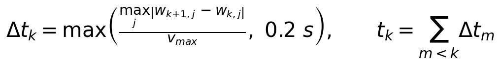

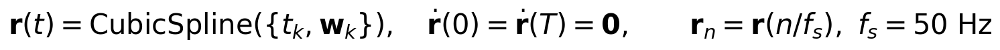

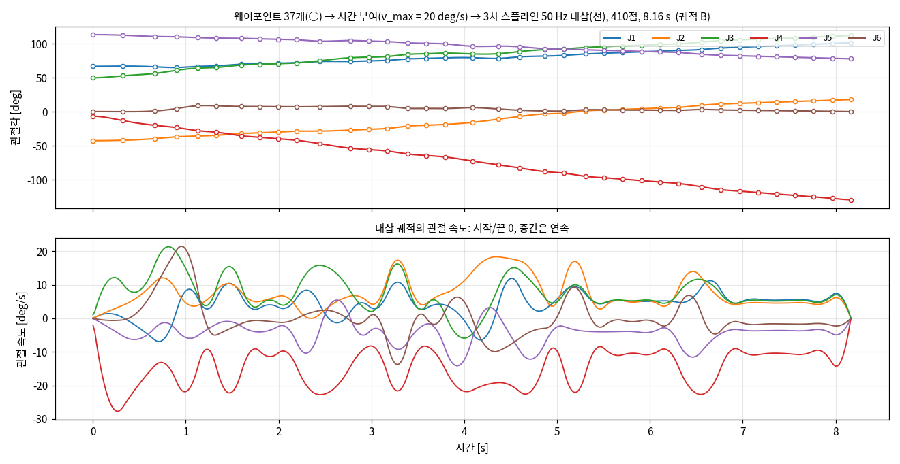

<a id="s1-3"></a>
### 1.3 로봇 지령 궤적 생성 (서브샘플링)

- 50 Hz 원본 전량 전송 시 TCP 명령 과다 → `s` 번째 점마다 추출해 지령점으로 사용
- 이번 실험: `s = 10`, **0.2 s 간격**, 마지막 점은 항상 포함

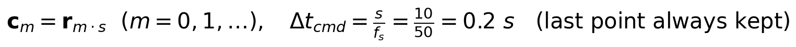

- 현 오차: 지령점 직선 연결 경로와 원본 곡선의 차이
  - 로봇이 지령점을 정확히 지나도 남는 오차 → 추종 오차의 **하한에 가까운 값**

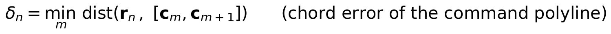

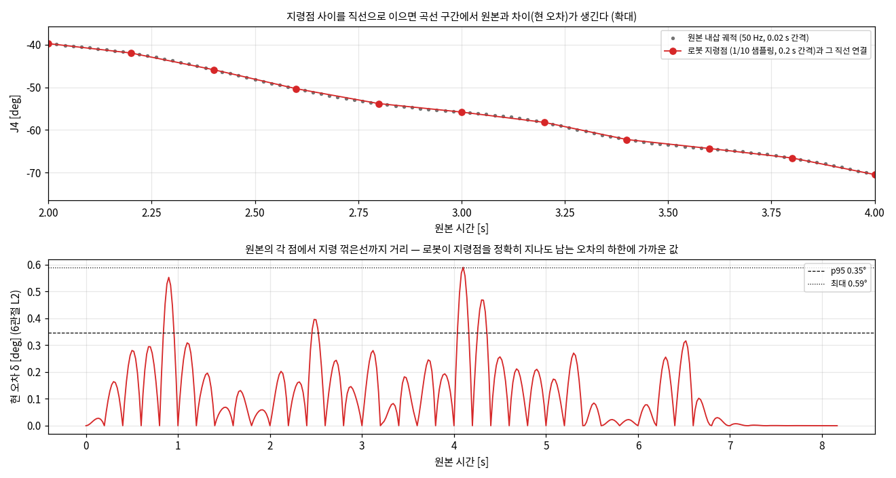

| 궤적 | 원본 길이 | 원본 점 수 (50 Hz) | 지령점 수 (0.2 s) | 경로 길이 (6관절 L2) | 현 오차 p95 | 현 오차 최대 |
|---|---|---|---|---|---|---|
| A (`waypoints_sample`) | 14.67 s | 735 | 75 | 452.4° | 0.41° | 0.67° |
| B (`waypoints_robot1`) | 8.16 s | 410 | 42 | 172.0° | 0.35° | 0.59° |
| C (`waypoints_robot2`) | 5.78 s | 291 | 30 | 134.6° | 0.36° | 0.44° |

- 3장 측정 결과의 추종 오차 최대값 ≈ 위 표의 현 오차 최대 → **현재 오차의 대부분은 지령 간격에서 발생**

<a id="s1-4"></a>
### 1.4 명령 전송과 동시 측정

- 명령 전송과 측정을 별도 TCP 연결·별도 스레드로 동시 수행

| 구분 | 포트 | 주기 | 내용 |
|---|---|---|---|
| 명령 | 5000 | servo: 0.2 s 고정 주기 / jb2: 리스트 구성 후 실행 1회 | 텍스트 한 줄 = 명령 하나 |
| 측정 | 5001 | 50 Hz (`reqdata`) | 관절각, 로봇 상태, 시뮬레이션/실기 모드 |

- 측정각 선택
  - 시뮬레이션: 엔코더 값 `jnt_ang` 가 0 으로 고정·미갱신 (실측 확인) → 지령 추종값 `jnt_ref` 사용
  - 실기: `jnt_ang` 사용
- 이전 명령 종료 대기
  - 직전 모션 종료 확인 후에만 다음 모션 명령 전송
  - 종료 기준: 측정각이 목표의 `reach_tol` 이내에 `reach_hold` 동안 유지 + `robot_state` idle(1)
  - 목표 미도달 상태로 정지 시 정체 시간 기준으로 중단
- 시작 자세
  - 추종 전 `move_j` 로 궤적 첫 점까지 이동 후 도달 확인
  - 해당 구간은 추종 평가에서 제외, 시작 각 오차에만 사용
- servo 전송 시점: 지령점 `c_m` 을 `(m−1)·0.2 s` 에 전송, `t1 = 0.2 s` 뒤 도달 목표

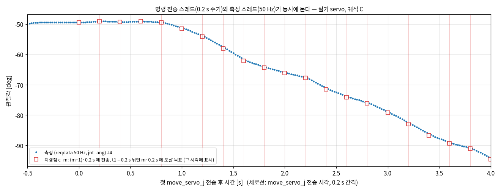

<a id="s1-5"></a>
### 1.5 DTW 매칭쌍 생성

- 같은 시각끼리 비교하지 않는 이유
  - 경로를 정확히 지나가도 늦은 출발·속도 차이가 있으면 같은 시각의 원본 점과 큰 차이 발생
  - move_jb2 는 실행 시간이 원본의 1.2 ~ 2.8배로 변동 (accel 120)
  - 평가 목적은 "경로를 정확히 지나갔는가" → 측정 샘플마다 **원본 경로 위 대응점**을 먼저 결정
- 최근접 점만 찾지 않는 이유
  - 같은 자세를 두 번 지나는 경로에서 다른 시간대 점과 우연히 짝지어질 위험
  - → **시간 순서 보존 DTW (Dynamic Time Warping)** 사용: 지연·선행은 허용, 시간 역행은 불허
- 누적 비용 계산: 측정 샘플 1개 진행 시 원본 점 0 ~ K 개 진행 허용

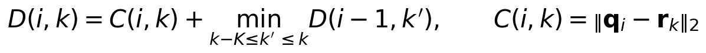

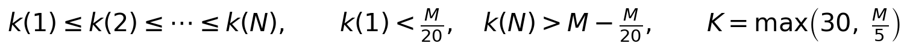

- 제약과 보정
  - 짝 순서 비감소(역행 없음), 시작은 원본 앞쪽 5 %, 끝은 뒤쪽 5 % 안에서 선택
  - DTW 결과(원본 50 Hz 정점)를 양옆 선분 위로 재투영 → 정점 간격만큼의 양자화 오차 제거 (`refine_pairs`)
  - 측정 샘플 수와 원본 점 수가 달라도 적용 가능 (건너뛰기, 다대일 매칭 허용)
- 예시 코드: `analysis.ordered_match` 를 풀어 쓴 형태 (실제 코드는 동일 계산의 벡터화 버전)

```python
import numpy as np
from scipy.spatial.distance import cdist

def ordered_match(meas, ref, K=None):
    """meas: (N,6) 측정 관절각, ref: (M,6) 원본 궤적.
    반환: 측정 샘플 i 에 짝지은 원본 점 번호 k(i) (감소하지 않음)."""
    N, M = len(meas), len(ref)
    K = K or max(30, M // 5)              # 측정 1샘플 동안 원본이 진행할 수 있는 최대 점 수
    C = cdist(meas, ref)                  # C[i, k] = ||q_i - r_k||
    D = np.full((N, M), np.inf)
    head = max(5, M // 20)
    D[0, :head] = C[0, :head]             # 시작은 원본 앞쪽에서만
    for i in range(1, N):
        for k in range(M):
            D[i, k] = C[i, k] + D[i - 1, max(0, k - K):k + 1].min()
    tail = max(5, M // 20)
    k = M - tail + int(np.argmin(D[-1, M - tail:]))   # 끝은 원본 뒤쪽에서만
    idx = [k]
    for i in range(N - 1, 0, -1):                       # 역추적
        lo = max(0, k - K)
        k = lo + int(np.argmin(D[i - 1, lo:k + 1]))
        idx.append(k)
    return np.array(idx[::-1])

# 사용 예: 늦게 출발하고 중간 속도가 다른 측정 신호
tr = np.linspace(0, 1, 60);  r = np.sin(2*np.pi*tr) + 0.5*np.sin(6*np.pi*tr)
tm = np.linspace(0, 1.25, 75); q = np.interp(np.clip((tm - 0.1) / 1.0, 0, 1) ** 1.15, tr, r)
k = ordered_match(q[:, None], r[:, None], K=8)
error = q - r[k]                          # 매칭쌍 기준 오차 (시간 어긋남은 포함되지 않음)
```

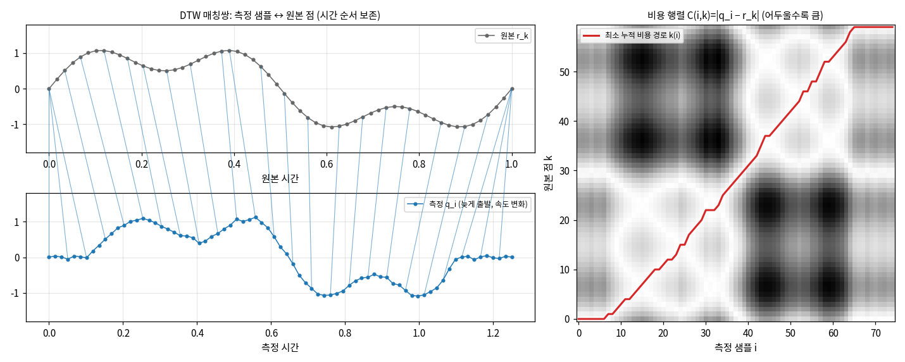

- 예시 그림 해석
  - 오른쪽 빨간 경로: 누적 비용 최소 짝
  - 늦게 출발한 앞부분: 경로 수평 유지 (원본 첫 점에 계속 매칭)
  - 이후: 원본을 따라 대각선 진행
- 실제 실행(궤적 C, servo) 매칭: 아래 측정 샘플과 위 원본 위치를 파란 선으로 연결

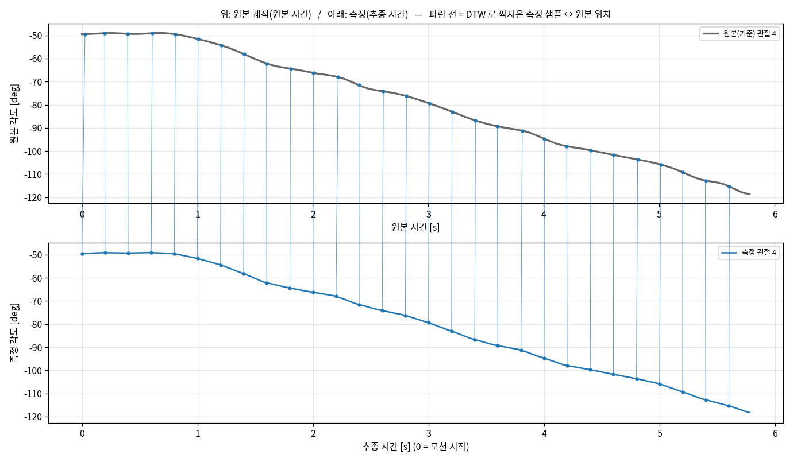

- 실행마다 저장되는 비교 그림 (실기 servo, 궤적 C)
  - 맨 아래: 측정 시간 대 매칭된 원본 시간
  - 점선(시작·끝만 맞춘 균일 비례)과 거의 겹침 → 시간 왜곡 작음

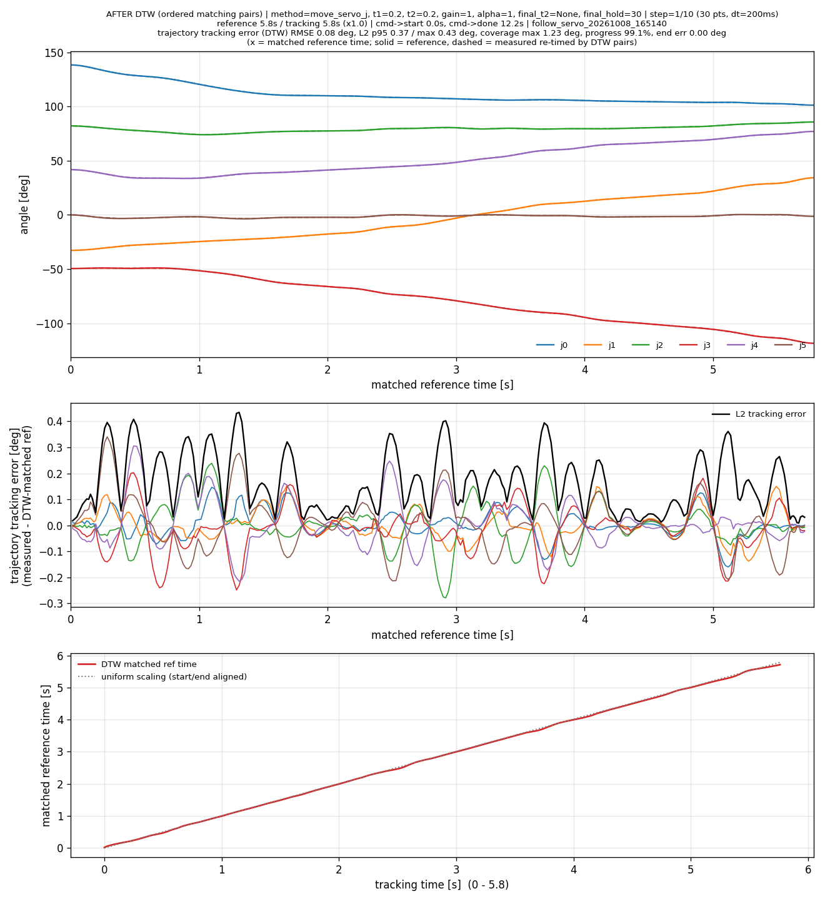

<a id="s1-6"></a>
### 1.6 실기 / 시뮬레이션 모드 평가 절차

| 항목 | 시뮬레이션 모드 | 실기 모드 |
|---|---|---|
| 모드 전환 명령 | `pgmode simulation` | `pgmode real` |
| 로봇 동작 | 움직이지 않음, 제어기 내부 지령값만 갱신 | 실제 구동 |
| 측정각 | `jnt_ref` (엔코더 값은 0 고정) | `jnt_ang` (엔코더) |
| 진입 조건 (시험 도구) | 기본값 | 확인 창에서 E-Stop 준비 확인 + `REAL` 직접 입력, 로봇 idle 상태 |
| 실행 중 감시 | 측정 스레드가 50 Hz 로 모드 값 확인, 변경 시 즉시 중단 | 동일 |
| 종료 후 | - | 시뮬레이션 모드 복귀 (선택), 실기 설정 미저장 |

- 시험 도구 "중지" 버튼 = `task stop` 전송일 뿐 **비상정지 아님** → 실기 시험 중 물리 E-Stop 을 손 닿는 곳에 배치
- 동일 궤적·파라미터로 시뮬레이션과 실기를 각각 수행해 같은 지표로 비교 (3.6절)

<a id="s1-7"></a>
### 1.7 평가 지표: 추종 오차와 추종 안정성

- 보고서에 사용한 지표만 정리 (전체 정의와 설명 그래프는 `docs/metrics.md`)

#### (1) 궤적 추종 오차

- 정의: 측정 샘플 `q_i` 와 DTW 로 짝지은 원본 위 점 `p_i` 의 차이, 6관절 벡터 L2 크기 (deg)

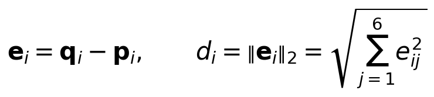

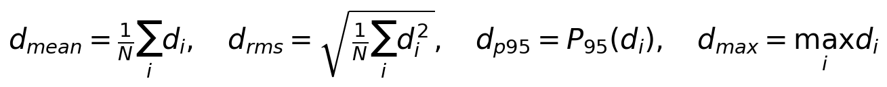

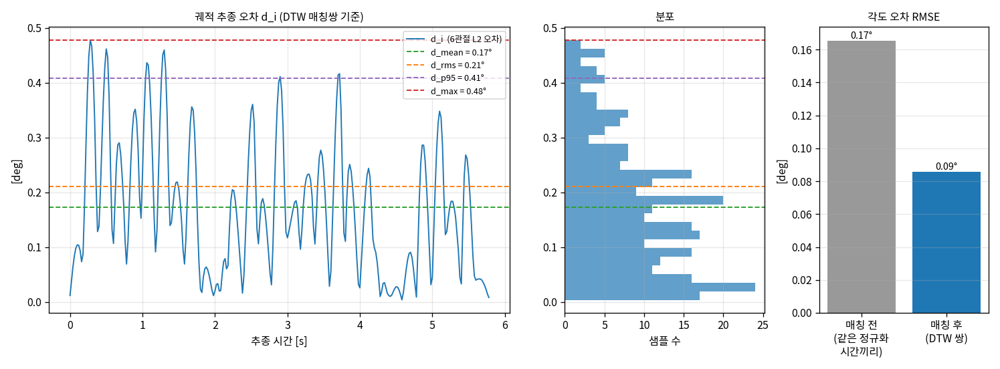

- 판정 기준: `d_p95 ≤ 1.0°`, `d_max ≤ 2.0°`
- 보조 지표
  - 커버리지: 원본 각 점에서 측정 경로까지 거리 → 경로 건너뜀 검출
  - 진행도: 원본 경로를 어디까지 지나갔는지

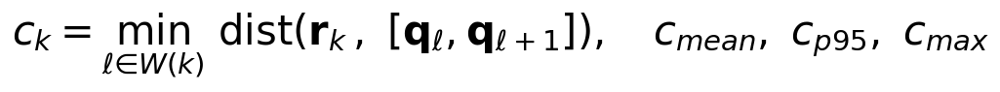

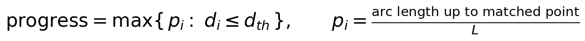

#### (2) 시작 / 종료 각 오차

- 추종 오차와 별도로, 정지 자세와 목표의 차이를 평가
- 정의: 추종 끝 안정 구간 중앙값과 원본 마지막 점의 관절별 차이 중 최댓값

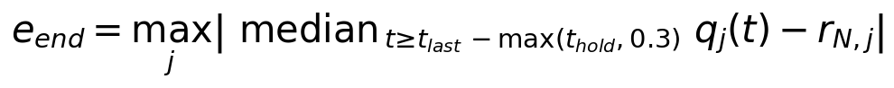

#### (3) 추종 안정성 (매끄러움)

- 원칙: **경로 자체의 꺾임·비매끄러움은 감점하지 않음** → 경로 모양과 무관한 양만 사용
- 준비: 경로를 따라간 속력(진행도의 시간 변화율)과 그 느린 추세 산출

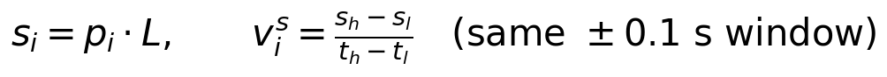

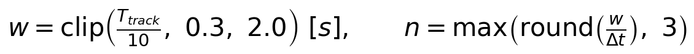

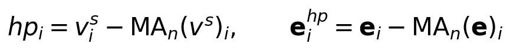

- **속도 리플 `R`** (참고 지표, 판정에 미사용)
  - 경로 속력의 추세 둘레 요동 크기 / 평균 속력
  - 가다 서다 반복 시 증가
  - 명령 방식 간 트레이드오프 비교에 사용 (3.5절)

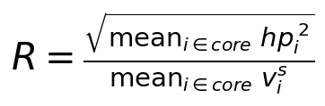

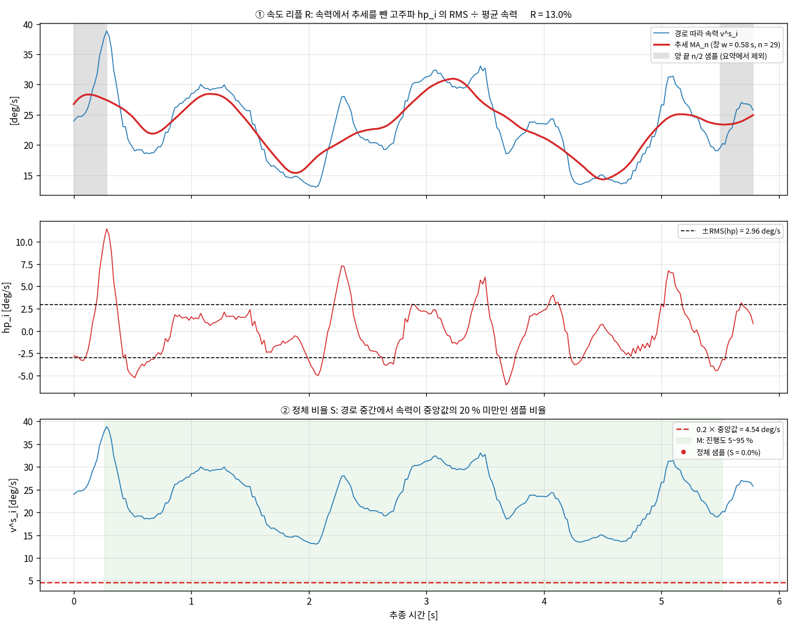

- **횡방향 흔들림 `W`**
  - 경로 수직 방향 벗어남 중 빠르게 떠는 성분의 RMS
  - 한쪽으로 꾸준히 치우친 성분은 추세로 분류 → `W` 가 아닌 추종 오차에 반영
  - 기준 `W ≤ 0.3°`

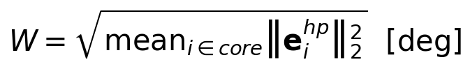

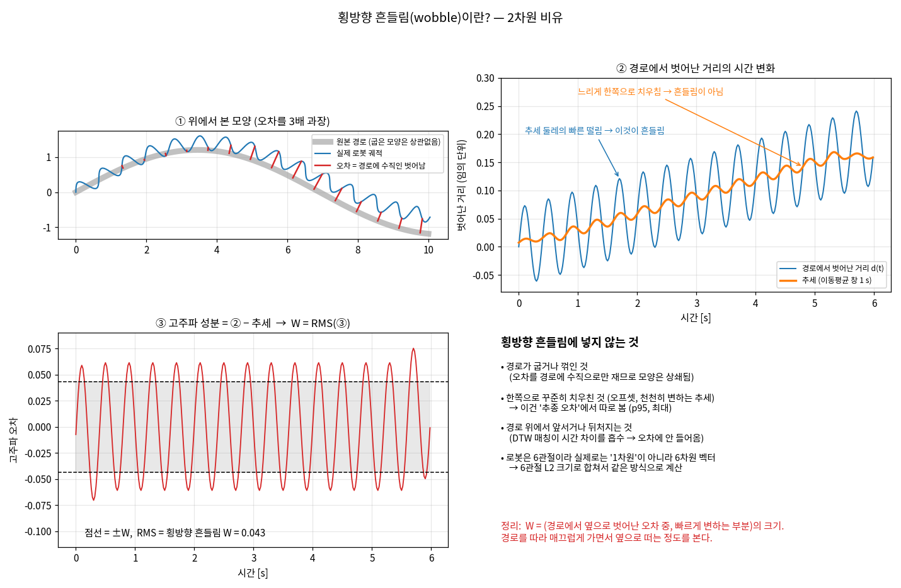

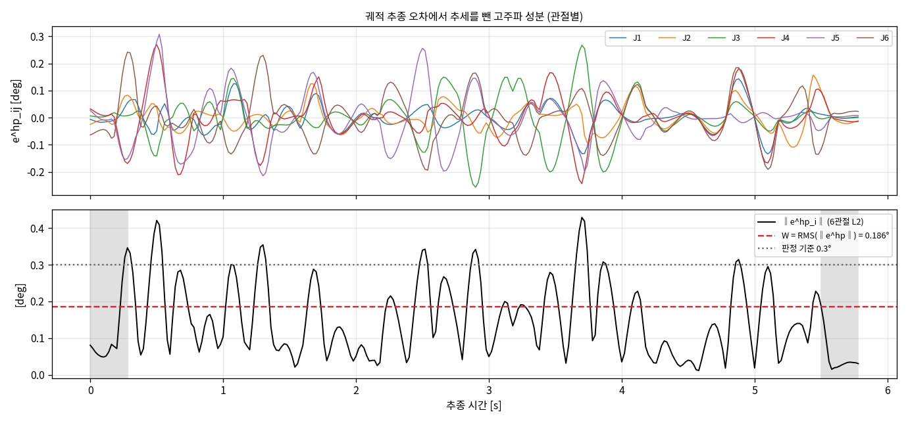

- **정체 비율 `S`**
  - 경로 중간(진행도 5 ~ 95 %)에서 속력이 중앙값의 20 % 미만인 샘플 비율
  - 멈칫거림 검출
  - 기준 `S ≤ 2 %`

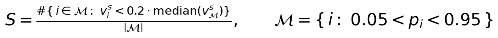

- 매끄러움 지도: 같은 지표를 샘플별 이동 창으로 계산, 거친 구간을 색으로 표시 (실기 servo, 궤적 C)

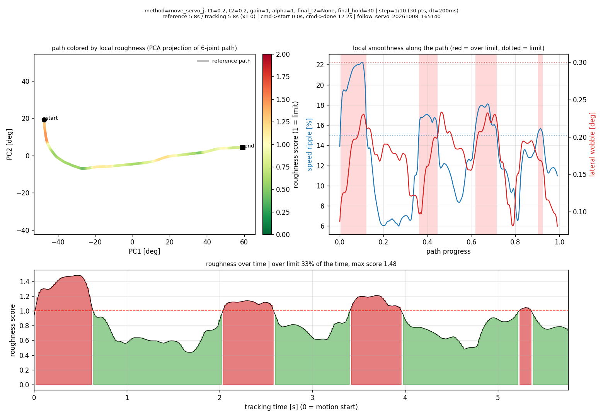

#### (4) 판정 기준

- 8개 항목 전부 통과 시 PASS: 추종 오차 p95, 최대, 커버리지, 진행도, 샘플 간 이동, 시작/종료 각 오차, 흔들림, 정체
- 속도 리플은 판정에서 제외
  - 리플은 명령 방식(blend 등)에 따라 구조적으로 정해지는 값 → 합격/불합격이 아닌 트레이드오프 비교 대상
- **합격선은 응용 요구가 아닌 임의 초기값**

---

<a id="s2"></a>
## 2. 로봇 인터페이스: 외부 스크립트와 UI Script

- 참고 문서: [외부 스크립트 API](https://rainbowrobotics.github.io/rb_cobot_docs/ko/manual/appendix/ext_script_api), [UI Script](https://rainbowrobotics.github.io/rb_cobot_docs/ko/technical_docs/ui_script)

<a id="s2-1"></a>
### 2.1 구성

| 포트 | 역할 | 형식 |
|---|---|---|
| 5000 (명령) | UI Script 명령, 모드 전환, task 제어 | 텍스트 한 줄(`\n` 종료) = 명령 하나. 응답 `The command was executed` 또는 `The command is not allowed` |
| 5001 (데이터) | 로봇 상태 요청 | `reqdata` 전송 시 고정 길이 이진 패킷 응답 |

- 명령은 수신 즉시 실행, 별도 확인 절차 없음 → 전송 전 모드·목표값 확인 필요
- 연속 전송 시 구문 오류 사례
  - 응답 대기 없이 여러 줄을 몰아 보내면 TCP 가 줄을 합치거나 분할
  - 태블릿 표시: `syntax error at ' ' in this line: move_jb2_add(j`
  - 대응: `TCP_NODELAY` 설정, 리스트 구성 명령은 한 줄마다 응답 대기 후 다음 줄 전송

<a id="s2-2"></a>
### 2.2 상태 데이터 (reqdata)

- 형식: 리틀엔디안 580바이트, 오프셋은 바이트 단위
- 헤더 확인: 첫 바이트 `0x24`, 네 번째 바이트 `0x03`
- 본 프로젝트 사용 필드

| 오프셋 | 형식 | 필드 | 사용 |
|---|---|---|---|
| 4 | float | 제어기 시간 | 기록 |
| 8 | float × 6 | `jnt_ref` 관절 지령값 [deg] | 시뮬레이션 측정각 |
| 32 | float × 6 | `jnt_ang` 관절 엔코더값 [deg] | 실기 측정각 (시뮬레이션에서는 0) |
| 104 | float × 6 | `tcp_pos` | 미사용 (URDF 검증에 활용 가능, 미확인) |
| 340 | int | `robot_state` (1 = idle, 3 = 실행 중) | 모션 종료 확인 |
| 404 | int | `real_vs_simulation_mode` (1 = 시뮬레이션) | 모드 감시 |

<a id="s2-3"></a>
### 2.3 UI Script 문법 예시

- 관절값 전달: 임시 변수 `jnt[j0, j1, j2, j3, j4, j5]` (deg), 별도 선언 불필요
- 예시 관절값: 궤적 B 의 첫 지령점들

**모드 전환**

```
pgmode simulation
pgmode real
```

**관절 이동 `move_j(J, 속도 deg/s, 가속도 deg/s², 대기 0/1)`** — 대기 기본값 1

```
move_j(jnt[0,0,0,0,0,0], 20, 40)
move_j(jnt[66.7570,-42.4990,49.9020,-6.5370,113.2200,0.3630], 50, 120)
```

**블렌딩 경로 `move_jb2_*`** — 리스트에 여러 점 적재 후 일괄 실행 (시간 기반 블렌딩)

```
move_jb2_clear()
move_jb2_add(jnt[66.9632,-42.2424,51.4177,-9.6759,112.9050,0.2800], 50, 120, 0, 100)
move_jb2_add(jnt[67.0438,-41.5110,53.5442,-14.9398,111.9343,0.1912], 50, 120, 0, 100)
...
move_jb2_run(0)
```

- `move_jb2_add(J, 속도, 가속도, 0, 블렌드 비율 %)`: 네 번째 인자는 더미
- `move_jb2_run(대기)`: 0 이면 실행 시작 후 즉시 반환

**서보 `move_servo_j(J, t1, t2, gain, alpha)`** — 목표 관절각 실시간 갱신

```
move_servo_j(jnt[66.9632,-42.2424,51.4177,-9.6759,112.9050,0.2800], 0.2, 0.2, 1, 1)
move_servo_j(jnt[67.0438,-41.5110,53.5442,-14.9398,111.9343,0.1912], 0.2, 0.2, 1, 1)
...   (0.2 s 마다 다음 점 전송)
```

**작업(task) 제어**

```
task load my_task
task repeat 1
task play once
task pause
task resume_a
task stop
```

**터미널 직접 전송** (시뮬레이션 모드에서 시험)

```bash
# 명령 포트: 한 줄씩 입력하면 응답이 돌아온다
nc 10.0.2.7 5000
pgmode simulation
move_j(jnt[0,0,0,0,0,0], 20, 40)

# 데이터 포트: 580바이트 이진 응답 (16진수로 확인)
printf 'reqdata\n' | nc -q 1 10.0.2.7 5001 | xxd | head
```

**Python 최소 예시**

```python
import socket, struct
cmd = socket.create_connection(("10.0.2.7", 5000))
dat = socket.create_connection(("10.0.2.7", 5001))
cmd.sendall(b"pgmode simulation\n"); print(cmd.recv(256))
cmd.sendall(b"move_j(jnt[0,0,0,0,0,0], 20, 40)\n"); print(cmd.recv(256))

dat.sendall(b"reqdata\n")
buf = b""
while len(buf) < 580:
    buf += dat.recv(580 - len(buf))
jnt_ref = struct.unpack_from("<6f", buf, 8)
jnt_ang = struct.unpack_from("<6f", buf, 32)
robot_state, = struct.unpack_from("<i", buf, 340)
is_sim, = struct.unpack_from("<i", buf, 404)
```

<a id="s2-4"></a>
### 2.4 사용 시 주의사항

- 명령은 확인 없이 즉시 실행, `pgmode real` 상태의 모션 명령은 실제 로봇 구동
- `task stop` 은 작업 정지 요청이며 비상정지 아님
- 시뮬레이션에서 `jnt_ang` = 0 → 도달 판단에 사용 금지 (미도달 상태를 도달로 판단해 다음 명령이 나간 사례 있음)
- `move_servo_j` 문서상 범위: `t1 ≥ 0.002 s`, `0.02 < t2 < 0.2 s`, `gain > 0`, `0 < alpha < 1`
  - 이번 실험 `t2 = 0.2`, `alpha = 1.0` 은 **문서 범위의 경계값**
  - 제어기 거부는 없었으나 문서상 열린 구간 → 범위 내 값(예: `t2 = 0.1`, `alpha = 0.9`)으로 재확인 필요
- `t1` 보다 짧은 간격의 서보 명령 중첩 동작은 문서에 없음 → 이번 실험은 명령 주기 = `t1` = 0.2 s

---

<a id="s3"></a>
## 3. 실기 및 시뮬레이션 성능 평가

<a id="s3-1"></a>
### 3.1 실험 조건과 비교 대상

| 항목 | 값 |
|---|---|
| 로봇 / URDF | rb20_1900es (RT) / `urdf/rb20_1900es_RT.urdf` (링크 표면 변위 계산에 사용) |
| 궤적 | A `waypoints_sample` (14.67 s), B `waypoints_robot1` (8.16 s), C `waypoints_robot2` (5.78 s) |
| 내삽 | 시간 부여 `v_max = 20 deg/s`, 3차 스플라인 50 Hz |
| 지령 간격 | 1/10 서브샘플링 → 0.2 s |
| 측정 | `reqdata` 50 Hz |

- 비교 대상: **궤적 3종 모두를 시뮬레이션과 실기로 수행한 조건만** 사용 (총 24회)

| 명령 방식 | 파라미터 | 궤적 | 모드 | 횟수 |
|---|---|---|---|---|
| jb2 blend 0 | speed 50, accel 120, blend 0 | A, B, C | 시뮬 / 실기 | 6 |
| jb2 blend 50 | speed 50, accel 120, blend 50 | A, B, C | 시뮬 / 실기 | 6 |
| jb2 blend 100 | speed 50, accel 120, blend 100 | A, B, C | 시뮬 / 실기 | 6 |
| servo | t1 = t2 = 0.2, gain 1, alpha 1, 마지막 점 30회 반복 | A, B, C | 시뮬 / 실기 | 6 |

- 제외 조건 (궤적·모드 일부만 수행 → 비교 불가)
  - jb2 accel 500 (시뮬레이션 위주), accel 180 / 200 (실기 궤적 B 만)
  - servo gain 0.2, alpha 0.5
  - 분석 결과가 없는 실기 1회 (`164030`)
- 원본 궤적은 시간 간격을 요구하지 않고 **순서만 보존**하면 됨 → 실행 시간은 평가하지 않음 (표의 추종 시간은 참고값)

<a id="s3-2"></a>
### 3.2 명령어와 파라미터

- 시작 자세 이동: 두 방식 모두 `move_j(c_0, speed, accel)` 로 동일

#### move_jb2 (블렌딩 관절 이동)

```
move_jb2_clear()
move_jb2_add(c_1, 50, 120, 0, blend)   # c_1 ~ c_M 까지 반복, 한 줄마다 응답 대기
move_jb2_run(0)
```

| 파라미터 | 의미 | 값 |
|---|---|---|
| `speed` | 관절 속도 [deg/s] (상한) | 50 |
| `accel` | 관절 가속도 [deg/s²] | 120 |
| `blend` | 이웃 점과의 블렌딩 비율 [%]. 0 이면 점마다 정지 | 0, 50, 100 |

- 시간 지정 없음 → 실행 속도는 속도·가속도·블렌드로 결정
- 지령점 간격이 촘촘해 `speed` 도달 전 감속 필요
  - 실제 속력 상한 ≈ `√(accel × 점 사이 거리)`
  - 궤적 B (점 사이 평균 4.2°), accel 120 → 약 22 deg/s, 측정 최고 속력(약 20 deg/s)과 유사 (3.3절 그림)
- 리스트 구성(`move_jb2_add` 반복): 점당 약 10 ms (응답 대기 포함, 궤적 A 75점 기준)

#### move_servo_j (실시간 서보)

```
move_servo_j(c_m, 0.2, 0.2, 1, 1)      # m = 1 .. M, 0.2 s 마다 전송
move_servo_j(c_M, 0.2, 0.2, 1, 1)      # 마지막 점을 30 번 더 반복
```

| 파라미터 | 문서상 의미 | 값 |
|---|---|---|
| `t1` | 도달 시간 [s] (≥ 0.002) | 0.2 (= 명령 주기) |
| `t2` | 유지 시간 [s] (0.02 < t2 < 0.2) | 0.2 |
| `gain` | 속도 추종 비율 (> 0) | 1.0 |
| `alpha` | 저역 통과 필터 (0 < alpha < 1) | 1.0 |
| `final_hold` | (시험 도구) 마지막 점 반복 횟수 | 30 |

- 지령마다 도달 시간 지정 → 명령 주기(0.2 s)에 따라 진행
- 이 절과 3.3 ~ 3.7절의 servo 는 **원본 시간 간격(0.2 s)으로 지령점을 보내는 방식**(`original`)이다. 속도·가속도로 프로파일을 만들어 20 ms 주기로 보내는 방식은 3.8절
- 종료 오버슈트 (문서에 없는 동작, 관측 결과)
  - 마지막 지령 후 마지막 지령 속도 × `t2` 만큼 더 진행 후 정지
  - 대응: 마지막 점 반복 전송으로 마지막 지령 속도를 0 으로 만듦

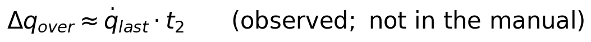

- 효과
  - 마지막 점 미반복 이전 실행(`20261008_132802`): 종료 각 오차 3.59°
  - `final_hold = 30` 적용 이번 실험: 전부 0.00°

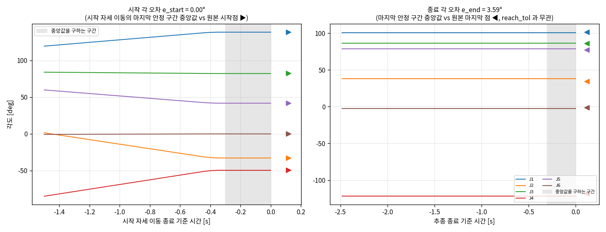

<a id="s3-3"></a>
### 3.3 move_jb2 결과

- 조건: speed 50 deg/s, accel 120 deg/s² 고정, blend 0 / 50 / 100

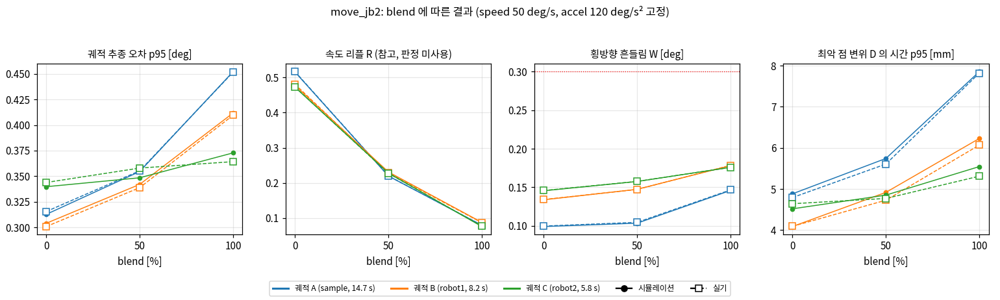

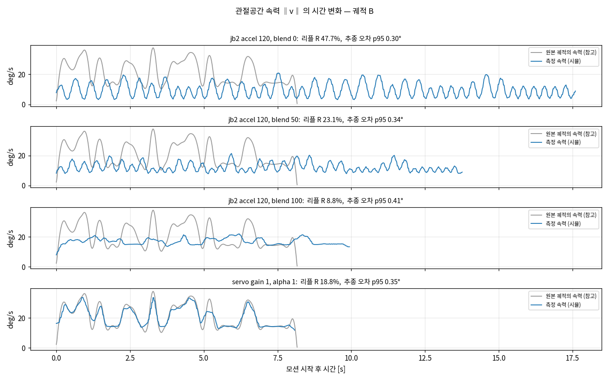

- 표: 시뮬 / 실기 (같으면 한 값), `D` 는 최악 점 변위 (rb20_1900es_RT)

| 궤적 | blend | 추종 [s] (참고) | d_p95 [°] | d_max [°] | 리플 R | 흔들림 W [°] | D 시간 평균 [mm] | D 시간 p95 [mm] | D 시간 최대 [mm] |
|---|---|---|---|---|---|---|---|---|---|
| A | 0 | 41.5 | 0.31 / 0.32 | 0.66 | 51.5 / 51.6 % | 0.10 | 1.36 / 1.39 | 4.9 / 4.8 | 13.7 / 13.8 |
| A | 50 | 32.1 | 0.35 / 0.36 | 0.66 | 22.0 % | 0.10 | 1.76 / 1.79 | 5.7 / 5.6 | 14.8 / 14.3 |
| A | 100 | 22.7 | 0.45 | 0.67 / 0.66 | 8.0 % | 0.15 | 2.58 / 2.61 | 7.9 / 7.8 | 15.5 / 13.7 |
| B | 0 | 17.6 | 0.30 | 0.59 | 47.7 / 48.1 % | 0.13 | 1.15 / 1.19 | 4.1 | 10.0 / 10.3 |
| B | 50 | 13.8 | 0.34 | 0.58 | 23.1 / 22.8 % | 0.15 | 1.46 / 1.49 | 4.9 / 4.7 | 10.0 / 9.7 |
| B | 100 | 9.9 | 0.41 | 0.58 | 8.8 / 8.7 % | 0.18 | 1.99 / 2.06 | 6.2 / 6.1 | 9.8 / 10.4 |
| C | 0 | 14.6 | 0.34 | 0.44 | 47.2 / 47.3 % | 0.15 | 1.47 / 1.50 | 4.5 / 4.6 | 8.6 / 8.0 |
| C | 50 | 11.5 | 0.35 / 0.36 | 0.43 / 0.44 | 22.8 / 22.7 % | 0.16 | 1.85 / 1.87 | 4.9 / 4.8 | 8.6 |
| C | 100 | 8.4 | 0.37 / 0.36 | 0.43 / 0.44 | 7.6 / 7.7 % | 0.18 | 2.49 | 5.5 / 5.3 | 8.5 / 8.4 |

**해석**

- blend 0
  - 지령점마다 감속·정지 → 속력 톱니 형태, 리플 47 ~ 52 %
  - 지령점 직선 연결 경로를 따라감 → 추종 오차 p95 최소 (0.30 ~ 0.34°), 표면 변위 평균·p95 도 최소
- blend 100
  - 속력 균일 유지 → 리플 8 ~ 9 %
  - 지령점 근처 모서리 깎임 → 추종 오차 p95 가 blend 0 대비 0.03 ~ 0.14° 증가 (궤적 A 에서 최대), 표면 변위 평균 약 1.7 ~ 1.9배
- blend 50: 오차·리플 모두 중간
- 추종 오차 최대 `d_max`
  - blend 와 무관하게 궤적별로 거의 일정 (A 0.66, B 0.58, C 0.43 ~ 0.44°)
  - 1.3절 현 오차 최대(0.67 / 0.59 / 0.44°)와 동일 → 지령 간격에서 기인
- 횡방향 흔들림 `W`: 0.10 ~ 0.18°, 전부 기준(0.3°) 이내, blend 가 클수록 약간 증가

<a id="s3-4"></a>
### 3.4 move_servo_j 결과

- 조건: `t1 = t2 = 0.2 s`, gain 1, alpha 1, 마지막 점 30회 반복
- 표: 시뮬 / 실기 (같으면 한 값)

| 궤적 | 추종 [s] (참고) | d_p95 [°] | d_max [°] | 종료 오차 [°] | 리플 R | 흔들림 W [°] | D 시간 평균 [mm] | D 시간 p95 [mm] | D 시간 최대 [mm] |
|---|---|---|---|---|---|---|---|---|---|
| A | 14.5 | 0.40 / 0.42 | 0.66 / 0.70 | 0.000 | 14.8 / 14.5 % | 0.14 / 0.15 | 2.11 / 2.28 | 6.5 / 6.9 | 16.0 / 14.8 |
| B | 8.1 | 0.35 | 0.59 / 0.58 | 0.000 | 18.8 / 19.3 % | 0.17 | 1.55 / 1.63 | 4.9 / 4.7 | 10.0 / 10.3 |
| C | 5.8 | 0.37 | 0.44 / 0.43 | 0.000 | 13.5 % | 0.18 | 2.09 / 2.19 | 4.9 / 5.3 | 8.5 / 8.6 |

**해석**

- 추종 오차 p95 0.35 ~ 0.42°, 리플 13.5 ~ 19.3 % → jb2 blend 50 과 100 사이
- 측정 속력이 원본 속력을 잘 추종 (3.3절 속력 그림 맨 아래)
  - 리플의 상당 부분은 0.2 s 지령 주기에 따른 속력 요동으로 판단
- 종료 각 오차: 마지막 점 반복으로 전부 0.000° (실기 0.0003°)
- 지령 지연(`t_latency`): 0.02 ~ 0.06 s

<a id="s3-5"></a>
### 3.5 명령 방식별 종합: 추종 오차와 속도 안정성의 트레이드오프

- 비교 축: 추종 오차(경로 정확도) ↔ 속도 안정성(리플·흔들림) → 그 결과로 메시에서 발생한 변위
- 4개 방식 모두 같은 구성 (궤적 A·B·C × 시뮬·실기, 각 6회)

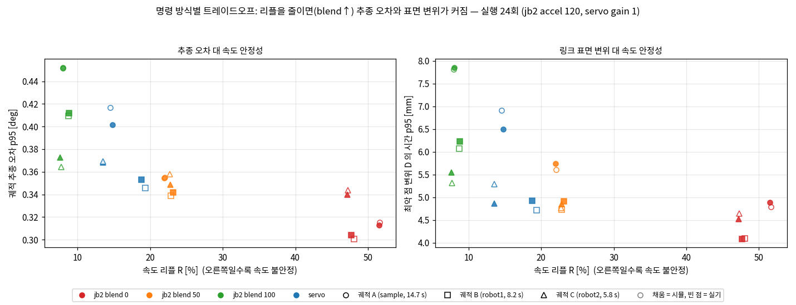

**종합 표** (값은 중앙값, 괄호는 최소 ~ 최대, `D` 는 rb20_1900es_RT 기준)

| 명령 방식 | 추종 오차 p95 [°] | 추종 오차 최대 [°] | 속도 리플 R | 흔들림 W [°] | D 시간 평균 [mm] | D 시간 p95 [mm] | D 시간 최대 [mm] |
|---|---|---|---|---|---|---|---|
| jb2 blend 0 | **0.31** (0.30 ~ 0.34) | 0.59 (0.44 ~ 0.66) | 48 % (47 ~ 52 %) | **0.13** (0.10 ~ 0.15) | **1.37** (1.15 ~ 1.50) | **4.6** (4.1 ~ 4.9) | 10.2 (8.0 ~ 13.8) |
| jb2 blend 50 | 0.35 (0.34 ~ 0.36) | 0.58 (0.43 ~ 0.66) | 23 % (22 ~ 23 %) | 0.15 (0.10 ~ 0.16) | 1.78 (1.46 ~ 1.87) | 4.9 (4.7 ~ 5.7) | 9.9 (8.6 ~ 14.8) |
| servo | 0.37 (0.35 ~ 0.42) | 0.58 (0.44 ~ 0.70) | 15 % (14 ~ 19 %) | 0.17 (0.14 ~ 0.18) | 2.10 (1.55 ~ 2.28) | 5.1 (4.7 ~ 6.9) | 10.2 (8.5 ~ 16.0) |
| jb2 blend 100 | 0.41 (0.36 ~ 0.45) | 0.58 (0.43 ~ 0.67) | **8 %** (8 ~ 9 %) | 0.18 (0.15 ~ 0.18) | 2.49 (1.99 ~ 2.61) | 6.1 (5.3 ~ 7.9) | 10.1 (8.4 ~ 15.5) |

- 트레이드오프
  - 추종 오차 p95: blend 0 < blend 50 < servo < blend 100
  - 속도 리플: 같은 순서로 반대 (48 → 23 → 15 → 8 %)
  - blend ↑ → 지령점 모서리를 둥글게 깎아 속도는 고르지만 경로에서 더 벗어남
  - blend 0 → 지령점 직선 경로를 그대로 따라가지만 점마다 감속·정지
  - servo → 오차·리플 모두 jb2 blend 50 과 100 사이
- 메시에서 발생한 오차
  - 표면 변위 시간 평균·p95 가 추종 오차 순서를 그대로 따름 (평균 1.37 → 2.49 mm, p95 4.6 → 6.1 mm)
  - 최악 순간 값(시간 최대)은 방식 간 차이 작음 (중앙값 9.9 ~ 10.2 mm), 궤적에 따라 8.0 ~ 16.0 mm
  - → 최악값은 방식보다 궤적과 지령 간격(현 오차)이 결정
- 흔들림 W: 전 방식 기준(0.3°) 이내, blend 0 이 가장 작음

<a id="s3-6"></a>
### 3.6 시뮬레이션과 실기 비교

- 대상: 비교 집합의 시뮬레이션·실기 12쌍
- 측정각: 시뮬레이션 `jnt_ref`, 실기 `jnt_ang`(엔코더)

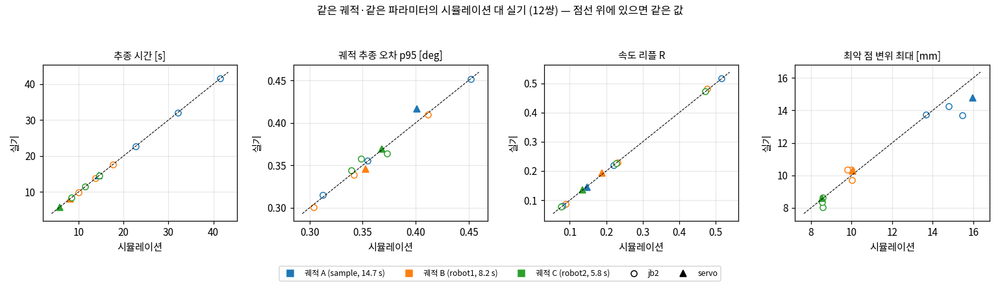

- 경로 기준 비교 (시간 무관): 실기 측정의 각 점에서 시뮬레이션 측정 경로까지 거리

| 방식 | 궤적 | 파라미터 | 경로 차이 p95 [°] | 경로 차이 최대 [°] |
|---|---|---|---|---|
| jb2 | A | blend 0 / 50 / 100 | 0.023 / 0.025 / 0.030 | 0.047 / 0.039 / 0.046 |
| jb2 | B | blend 0 / 50 / 100 | 0.021 / 0.022 / 0.025 | 0.033 / 0.090 / 0.034 |
| jb2 | C | blend 0 / 50 / 100 | 0.019 / 0.020 / 0.022 | 0.055 / 0.025 / 0.047 |
| servo | A / B / C | gain 1 | 0.056 / 0.037 / 0.036 | 0.085 / 0.065 / 0.051 |

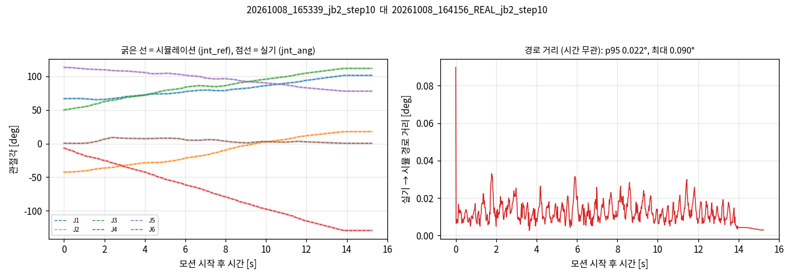

- 측정 경로 차이 최대 0.09° 이하, 추종 오차(0.3 ~ 0.7°)보다 한 자릿수 작음
  - servo 가 jb2 보다 약간 큼 (0.04 ~ 0.06° 대 0.02 ~ 0.03°)
- 추종 시간 차이 0.02 s 이내, 리플 차이 0.6 %p 이내
- 표면 변위
  - 시간 p95 차이 0.4 mm 이내
  - 시간 최대 차이는 최대 1.8 mm (궤적 A blend 100: 15.5 / 13.7 mm) → 최악 한 순간에 민감한 지표
- 결론: **이 속도 범위·무부하 조건에서는 시뮬레이션으로 실기 관절 경로 예측 가능**
  - 단, 실기 측정도 관절 엔코더 값 → 링크 처짐, 감속기 백래시, 공구 끝 위치 오차 미포함

<a id="s3-7"></a>
### 3.7 링크 메시 기준 변위

- 목적: 관절 오차(deg)를 로봇 표면의 실제 벗어남(mm)으로 환산
- 관절별 1° 오차가 만드는 최악 점 변위 (rb20_1900es_RT, 궤적 A 시작 자세)

| 관절 | J1 | J2 | J3 | J4 | J5 | J6 |
|---|---|---|---|---|---|---|
| 1° 당 변위 [mm] | 25.6 | 31.8 | 18.3 | 6.8 | 6.9 | 2.4 |

- 방법
  - URDF 링크 충돌 메시에서 링크당 표면 점 600개 추출
  - 추종 구간의 **매칭쌍 전체**에 대해 측정 자세 `q_i` 와 짝지은 원본 자세 `p_i` 를 각각 순기구학으로 배치
  - **같은 메시 점끼리의 거리** 측정
  - 대상: 팔 관절과 함께 움직이는 링크 (`rt_link1` ~ `rt_link_end`), 레일·캐리지 구조물 제외, 외부축은 두 자세 모두 0

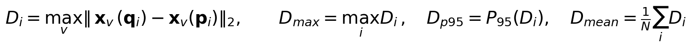

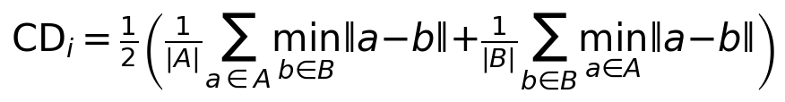

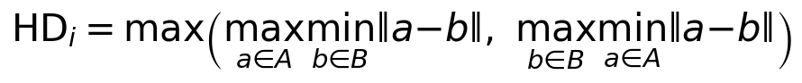

- 주 지표: **최악 점 변위 `D`**
  - Chamfer 는 평균값이라 최악 위치를 과소평가 (비교 집합에서 `D` 최대가 Chamfer 최대의 2.1 ~ 2.7배)
- 정밀도 확인 (실기 servo 궤적 A)
  - 공간 샘플링: 링크당 600점 최댓값과 메시 전체 정점 최댓값 차이 시계열 최대 기준 0.2 %
  - 시간 샘플링: 매칭쌍 일부(200개)만 쓰면 순간 최댓값을 놓침 (14.8 → 13.3 mm) → 본 보고서는 매칭쌍 전체 사용

**방식별 결과**

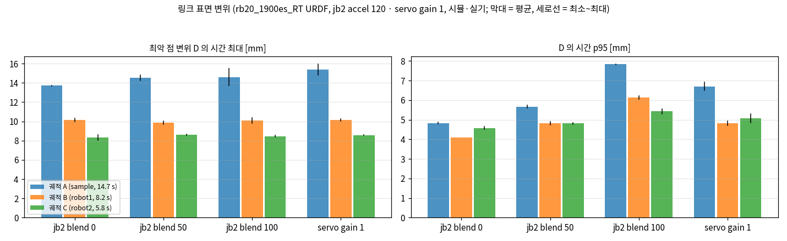

- `D` 시간 평균·p95: blend 0 < blend 50 < servo < blend 100 (3.5절 종합 표)
- `D` 시간 최대: 궤적 C 8.0 ~ 8.6 mm, B 9.7 ~ 10.4 mm, A 13.7 ~ 16.0 mm → 자세 변화가 큰 궤적일수록 큼, 방식 간 차이 작음

**궤적별 링크 변위**

- 값: 링크마다 "그 순간 해당 링크의 최악 점 변위"를 매칭쌍 전체로 구한 시계열의 최댓값 / P95 [mm]
- 링크: `rt_link1` (어깨 회전부) ~ `rt_link_end` (손끝), rt_link0 (베이스)은 변위 0 이라 생략
- 원본 수치(평균 포함): `link_displacement_rb20.csv`

**궤적 A (waypoints_sample)** — 링크별 변위 최댓값 / P95 [mm]

| 방식 | 모드 | link1 | link2 | link3 | link4 | link5 | link6 | link_end |
|---|---|---|---|---|---|---|---|---|
| jb2 blend 0 | 시뮬 | 0.7 / 0.3 | 8.1 / 3.2 | 7.8 / 3.1 | 11.6 / 4.0 | 11.8 / 4.1 | 11.9 / 4.2 | 13.7 / 4.9 |
| jb2 blend 0 | 실기 | 0.7 / 0.3 | 8.0 / 3.1 | 7.6 / 3.0 | 11.2 / 3.9 | 11.4 / 4.0 | 11.7 / 4.1 | 13.8 / 4.8 |
| jb2 blend 50 | 시뮬 | 0.8 / 0.3 | 8.2 / 3.5 | 7.9 / 3.4 | 12.0 / 4.8 | 12.2 / 4.9 | 12.6 / 5.0 | 14.8 / 5.7 |
| jb2 blend 50 | 실기 | 0.8 / 0.3 | 8.6 / 3.5 | 8.2 / 3.4 | 12.7 / 4.7 | 12.9 / 4.8 | 13.1 / 4.9 | 14.3 / 5.6 |
| servo | 시뮬 | 0.7 / 0.3 | 8.2 / 3.9 | 7.9 / 3.9 | 12.7 / 5.5 | 13.1 / 5.6 | 13.6 / 5.8 | 16.0 / 6.5 |
| servo | 실기 | 0.8 / 0.4 | 8.7 / 4.1 | 8.4 / 4.0 | 13.0 / 5.7 | 13.2 / 5.9 | 13.4 / 6.0 | 14.8 / 6.9 |
| jb2 blend 100 | 시뮬 | 0.8 / 0.4 | 8.1 / 4.4 | 7.8 / 4.4 | 12.3 / 6.7 | 12.7 / 6.8 | 13.2 / 7.0 | 15.5 / 7.9 |
| jb2 blend 100 | 실기 | 0.8 / 0.4 | 8.5 / 4.4 | 8.1 / 4.4 | 12.3 / 6.7 | 12.5 / 6.8 | 12.7 / 7.0 | 13.7 / 7.8 |

**궤적 B (waypoints_robot1)** — 링크별 변위 최댓값 / P95 [mm]

| 방식 | 모드 | link1 | link2 | link3 | link4 | link5 | link6 | link_end |
|---|---|---|---|---|---|---|---|---|
| jb2 blend 0 | 시뮬 | 1.0 / 0.4 | 4.9 / 2.1 | 5.5 / 2.1 | 9.6 / 3.5 | 10.0 / 3.5 | 9.1 / 3.5 | 9.4 / 4.0 |
| jb2 blend 0 | 실기 | 1.0 / 0.4 | 5.0 / 2.1 | 5.7 / 2.1 | 9.9 / 3.6 | 10.3 / 3.6 | 9.5 / 3.5 | 9.8 / 4.0 |
| jb2 blend 50 | 시뮬 | 1.0 / 0.4 | 4.9 / 2.3 | 5.5 / 2.3 | 9.6 / 4.5 | 10.0 / 4.6 | 9.1 / 4.3 | 9.5 / 4.8 |
| jb2 blend 50 | 실기 | 1.0 / 0.5 | 4.9 / 2.2 | 5.5 / 2.3 | 9.3 / 4.2 | 9.7 / 4.3 | 8.9 / 4.1 | 9.2 / 4.5 |
| servo | 시뮬 | 1.0 / 0.5 | 4.9 / 2.2 | 5.6 / 2.3 | 9.6 / 4.5 | 10.0 / 4.6 | 9.2 / 4.1 | 9.5 / 4.8 |
| servo | 실기 | 1.0 / 0.4 | 5.0 / 2.2 | 5.7 / 2.3 | 9.9 / 4.3 | 10.3 / 4.3 | 9.4 / 4.2 | 9.8 / 4.5 |
| jb2 blend 100 | 시뮬 | 1.0 / 0.5 | 4.9 / 2.5 | 5.5 / 2.5 | 9.4 / 5.2 | 9.8 / 5.4 | 9.0 / 5.1 | 9.3 / 6.1 |
| jb2 blend 100 | 실기 | 1.0 / 0.5 | 4.8 / 2.4 | 5.5 / 2.6 | 9.9 / 5.4 | 10.4 / 5.4 | 9.5 / 5.2 | 9.8 / 6.1 |

**궤적 C (waypoints_robot2)** — 링크별 변위 최댓값 / P95 [mm]

| 방식 | 모드 | link1 | link2 | link3 | link4 | link5 | link6 | link_end |
|---|---|---|---|---|---|---|---|---|
| jb2 blend 0 | 시뮬 | 0.4 / 0.3 | 3.2 / 2.0 | 2.9 / 1.9 | 6.7 / 3.6 | 6.5 / 3.7 | 6.9 / 3.8 | 8.6 / 4.5 |
| jb2 blend 0 | 실기 | 0.5 / 0.3 | 3.3 / 2.0 | 3.0 / 1.9 | 6.3 / 3.7 | 6.2 / 3.7 | 6.5 / 3.8 | 8.0 / 4.6 |
| jb2 blend 50 | 시뮬 | 0.4 / 0.3 | 3.2 / 2.1 | 2.9 / 2.0 | 6.6 / 3.9 | 6.5 / 3.9 | 6.9 / 4.0 | 8.6 / 4.9 |
| jb2 blend 50 | 실기 | 0.5 / 0.3 | 3.1 / 2.1 | 2.8 / 2.0 | 6.7 / 3.9 | 6.6 / 4.0 | 7.0 / 4.0 | 8.6 / 4.8 |
| servo | 시뮬 | 0.4 / 0.3 | 3.1 / 2.2 | 2.8 / 2.1 | 6.6 / 4.0 | 6.5 / 4.1 | 6.9 / 4.2 | 8.5 / 4.9 |
| servo | 실기 | 0.4 / 0.3 | 3.3 / 2.4 | 3.0 / 2.3 | 6.6 / 4.2 | 6.5 / 4.2 | 6.9 / 4.4 | 8.6 / 5.3 |
| jb2 blend 100 | 시뮬 | 0.4 / 0.3 | 3.2 / 2.2 | 2.9 / 2.2 | 6.6 / 4.5 | 6.5 / 4.7 | 6.9 / 4.8 | 8.5 / 5.5 |
| jb2 blend 100 | 실기 | 0.4 / 0.3 | 3.3 / 2.3 | 2.9 / 2.2 | 6.5 / 4.3 | 6.3 / 4.4 | 6.7 / 4.6 | 8.4 / 5.3 |

- 링크 위치에 따른 경향
  - 손끝으로 갈수록 변위 증가 (link1 1 mm 이하 → link_end 8 ~ 16 mm), 어깨·팔꿈치 관절 오차가 바깥 링크 전체를 이동시키기 때문
  - 궤적 B 는 link4 ~ link5 가 link6 ~ link_end 와 비슷하거나 큼 → 자세에 따라 최대 변위 링크가 달라짐
- 방식에 따른 경향
  - 손목 쪽 링크(link4 ~ link_end) P95: blend 0 < blend 50 ≈ servo < blend 100 (예: link_end P95 중앙값 4.6 / 4.8 / 5.1 / 6.1 mm) → 3.5절 트레이드오프와 같은 순서
  - 어깨 쪽 링크(link1 ~ link3) P95: 방식 간 차이가 손목 쪽보다 작음 (궤적 A 최대 1.4 mm, B·C 0.5 mm 이내)
  - 링크별 최댓값: 방식보다 궤적이 결정 (같은 궤적 안에서 방식 간 차이 최대 2.3 mm)
- 시뮬레이션 대 실기: 같은 조건에서 링크별 P95 차이 0.5 mm 이내

**실기 최대 사례: servo, 궤적 A** (`20261008_164846_REAL_servo_step10`)

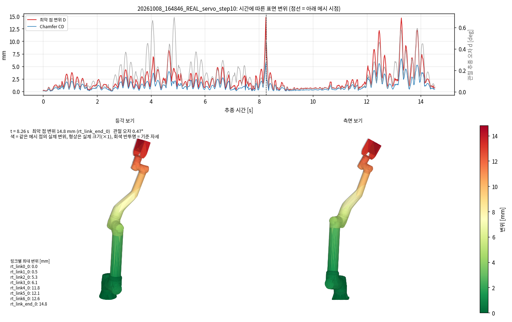

- t = 8.26 s, 관절 추종 오차 0.47°, 최악 점 변위 **14.8 mm** (`rt_link_end`)
- 표시: 형상은 실제 크기(확대 없음), 색은 같은 메시 점의 변위
- 해당 순간 링크별 최대 변위: link1 0.5, link2 5.3, link3 6.1, link4 11.8, link5 12.1, link6 12.6, link_end 14.8 mm
  - 어깨 쪽 관절 오차가 팔 끝 쪽 링크 전체를 이동시킴 → 바깥 링크일수록 큼
- 표면 변위는 관절 추종 오차(회색)와 함께 증감

**모델에 따른 차이**

- 같은 측정값이라도 팔이 클수록 mm 값 증가
- 같은 데이터를 rb10_1300e URDF 로 계산하면 시간 평균·p95 가 rb20_1900es_RT 의 약 0.6 ~ 0.7배 → URDF 선택이 결과에 직접 영향

<a id="s3-8"></a>
### 3.8 servo 프로파일 타이밍 (10/14 추가 실험, 실기·시뮬레이션)

**방식 변경** (3.2절의 servo 와 다른 점)

- 지령점을 원본 시간 간격으로 보내지 않고, **설정한 속도·가속도로 만든 프로파일**을 **20 ms 고정 주기**로 샘플링해 보냄
  - 프로파일: 원본 궤적 위에서 관절마다 \|속도\| ≤ speed, \|가속도\| ≤ accel 을 지키는 최단 시간 프로파일 (시작·끝에서만 정지, 굽은 곳에서는 감속)
  - 경로는 3차 스플라인으로 보간
  - 실제로 보낼 지령(20 ms 샘플)의 차분 속도·가속도를 계산해, 설정을 넘으면 계획용 한계를 낮춰 다시 만듦 → **지령은 항상 한계 이하** (이 절의 모든 실행에서 확인, 실기 3회의 지령 최대 가속도 48.9 ~ 49.9, 한계 50)
  - `t1` = 주기(20 ms), `t2` = 주기의 2배(0.04 s), gain 1, alpha 1, 마지막 점 반복
- 그래프의 점선 = 이 이상 프로파일
- **분석 코드 버전이 3.1 ~ 3.7절과 다름**: 이 절은 극값 앵커 기반 매칭(`matching.py`)과 모션 구간 끝 수정(마지막 샘플 = 원본 끝점 자세)이 반영된 현재 코드로 계산. 같은 코드로 10/08 데이터를 다시 계산하면 `d_max` 가 1.2 ~ 3.6° 로 달라지므로(3.1 ~ 3.7절은 이전 코드의 값) **두 절의 오차 값을 직접 비교하지 말 것**
- **이 절의 오차 정의**: 측정 샘플에서 **원본 경로(꺾은선)까지의 최단 거리** (시간 매칭 없음)
  - 현재 코드의 매칭쌍 거리(`path_dev_*`)는 실행마다 약 20개 샘플(전체의 3~6 %)이 극값 앵커에 강제로 짝지어져 **단발 스파이크**가 생김 (최단 거리보다 0.05° 이상 큰 샘플이 실행마다 19~25개)
  - 그 결과 매칭쌍 p95·최대가 0.35~0.55° 로 부풀어, 실제 경로 이탈(최대 0.07° 이하)을 반영하지 못함 → 이 절은 최단 거리를 사용하고, 매칭쌍 값은 CSV 에만 남김
  - 최단 거리는 시간 순서를 보지 않으므로 경로를 건너뛰거나 되돌아가는 것은 잡지 못함 (이 실행들은 종료 오차 0.001° 이하, 진행도 정상)

**실험 조건**

| 항목 | 값 |
|---|---|
| 실기 | 3회: 궤적 A·B·C 각 1회, speed 30 deg/s, accel 50 deg/s² |
| 시뮬레이션 | 지령 한계 수정 이후 12회 (궤적 A·B·C, speed 20 ~ 50, accel 40 ~ 100) |
| 제외 | 지령 한계 수정 이전 실행 6회 (지령 가속도가 한계 초과), alpha 0.5 실행 |

**실기 결과** (궤적 A·B·C, 30 / 50)

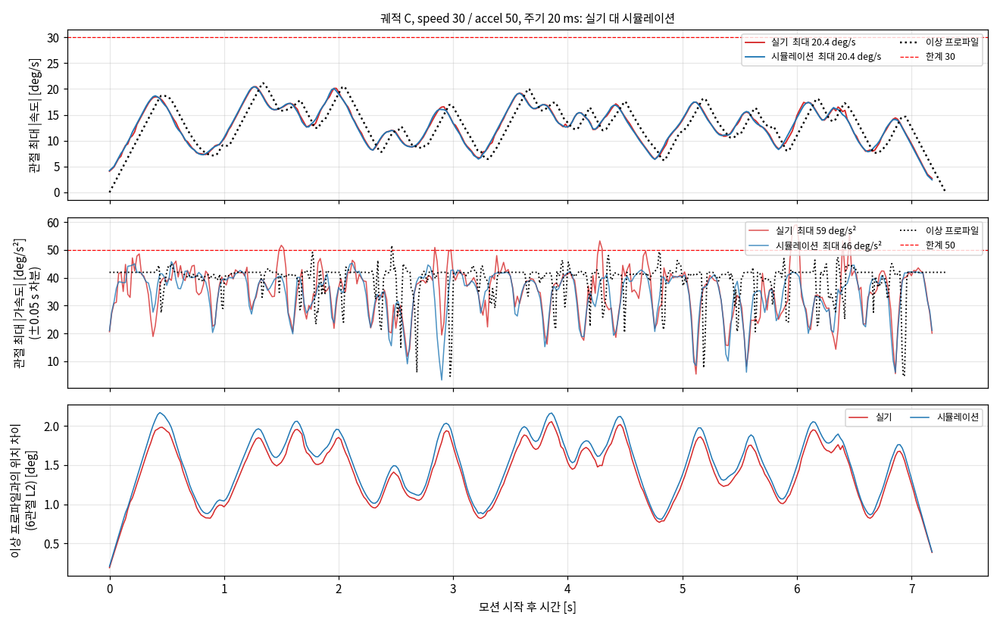

| 궤적 | 이상 시간 [s] | 측정 시간 [s] | 경로까지 거리 p95 [°] | 경로까지 거리 최대 [°] | 종료 오차 [°] | 리플 R | 흔들림 W [°] | 측정 최대 속도 | 측정 최대 가속도 |
|---|---|---|---|---|---|---|---|---|---|
| A | 14.84 | 14.72 | 0.054 | 0.074 | 0.001 | 21.6 % | 0.06 | 31.8 (한계 30) | 77 (한계 50) |
| B | 8.62 | 8.52 | 0.035 | 0.051 | 0.001 | 19.1 % | 0.05 | 27.8 | 67 |
| C | 7.30 | 7.18 | 0.029 | 0.040 | 0.001 | 17.2 % | 0.05 | 20.4 | 59 |

- 경로 추종은 양호: 원본 경로까지의 거리 p95 0.03 ~ 0.05°, 최대 0.04 ~ 0.07°, 종료 오차 0.001° 수준 (모든 샘플이 0.1° 이내)
- 측정 시간은 이상 시간보다 0.1 s 정도 짧음
- 측정 속도는 한계 이내 (A 의 31.8 은 한계 30 의 6 % 초과, 100 ms 차분 오차 범위)
- **측정 가속도는 한계 50 을 넘음** (A 77, B 67, C 59)
  - 지령 자체는 한계 이하 (지령 최대 가속도 48.9 ~ 49.9) → 초과는 제어기 응답 또는 엔코더 차분 노이즈에서 발생
  - 둘 중 어느 쪽인지 구분하지 못함 (엔코더 값을 먼저 평활한 뒤 다시 재야 확인 가능)
- 속도 리플 17 ~ 22 %

**실기 대 시뮬레이션** (같은 조건은 궤적 C 한 쌍뿐)

| 항목 | 시뮬레이션 | 실기 |
|---|---|---|
| 경로까지 거리 p95 / 최대 | 0.010° / 0.013° | 0.029° / 0.040° |
| 속도 리플 | 17.3 % | 17.2 % |
| 측정 최대 속도 | 20.4 | 20.4 |
| 측정 최대 가속도 | 46 | 59 |
| 추종 시간 | 7.18 s | 7.18 s |

- 두 경로의 거리: p95 0.028°, 최대 0.038° (3.6절의 servo 쌍 0.036 ~ 0.056° 와 같은 수준)
- 경로까지의 거리는 실기가 시뮬레이션의 약 3배 (0.029 대 0.010°)이나 모두 0.05° 이하
- 속도·가속도에서도 차이: 가속도 46 대 59
- 궤적 A·B 는 같은 조건(30 / 50)의 시뮬레이션이 없어 비교하지 못함

**시뮬레이션: 속도·가속도 설정의 영향** (alpha 1, 시뮬레이션 평균, 추종 오차 최대는 최댓값)

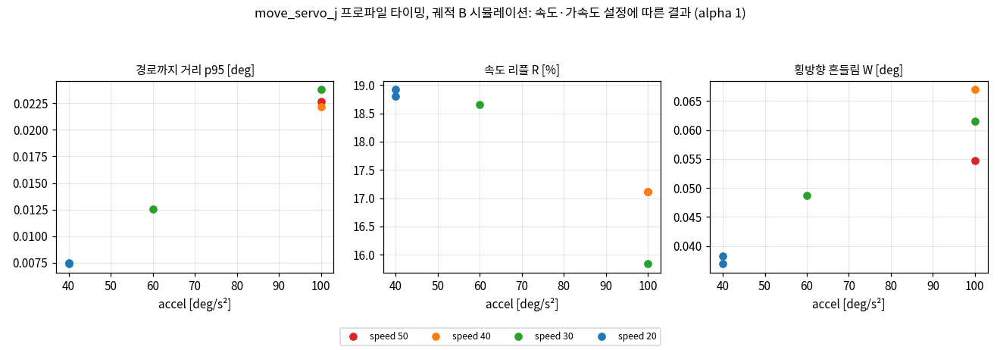

| 궤적 | speed / accel | 횟수 | 경로까지 거리 p95 [°] | 경로까지 거리 최대 [°] | 리플 R | 흔들림 W [°] | 측정 최대 속도 | 측정 최대 가속도 | 종료 오차 최대 [°] |
|---|---|---|---|---|---|---|---|---|---|
| A | 20 / 40 | 3 | 0.007 | 0.011 | 19.4 % | 0.03 | 20.3 | 40 | 0.446 |
| B | 20 / 40 | 2 | 0.007 | 0.011 | 18.9 % | 0.04 | 20.2 | 39 | 0.000 |
| B | 30 / 60 | 1 | 0.013 | 0.014 | 18.6 % | 0.05 | 29.6 | 61 | 0.000 |
| B | 30 / 100 | 1 | 0.024 | 0.033 | 15.8 % | 0.06 | 35.9 | 282 | 0.000 |
| B | 40 / 100 | 1 | 0.022 | 0.025 | 17.1 % | 0.07 | 38.3 | 105 | 0.000 |
| B | 50 / 100 | 1 | 0.023 | 0.026 | 17.1 % | 0.05 | 38.2 | 100 | 0.000 |
| C | 20 / 40 | 2 | 0.007 | 0.010 | 17.6 % | 0.05 | 18.4 | 37 | 0.000 |
| C | 30 / 50 | 1 | 0.010 | 0.013 | 17.3 % | 0.05 | 20.4 | 46 | 0.000 |

- 속도·가속도를 낮출수록 경로까지 거리가 줄어듦 (궤적 B: 50 / 100 → 0.023°, 30 / 60 → 0.013°, 20 / 40 → 0.007°), 단 전체가 0.04° 이하라 차이는 작음
- 리플은 15 ~ 19 % 로 설정에 따른 뚜렷한 경향이 없음
- 측정 속도는 설정 한계의 1.02배 이내 (20 / 40 의 20.3 이 최대)
- 측정 가속도는 대체로 한계 부근 (B 20 / 40 의 39, 30 / 60 의 61, 50 / 100 의 100)
  - 이상값: B 30 / 100 의 282 (한 번뿐, 원인 미확인)
- 종료 오차는 한 실행(궤적 A, 20 / 40 첫 번째)을 빼면 0.000°
  - 0.446° 는 마지막 점에 수렴하지 못한 것으로 보임, 같은 조건 재실행 2회는 0.000°
- 실기 3회와 같은 한계(30 / 50)의 시뮬레이션 데이터는 궤적 C 한 건뿐이므로, 시뮬레이션 결과로 실기 값을 예측한다고 일반화할 수는 없음

**이전 servo (3.4절) 대비**

- 이전: 원본 시간 간격(0.2 s)으로 지령점 전송, 지령 간격이 길어 속도가 계단 모양으로 바뀜
- 이번: 20 ms 고정 주기, 속도·가속도 한계를 지키는 지령
- 분석 코드 버전이 달라 두 방식의 오차는 수치로 직접 비교하지 않음

---

<a id="s4"></a>
## 4. 결론과 권장 사항

1. **명령 방식 선택은 추종 오차와 속도 안정성 사이의 트레이드오프**
   - 오차 우선: jb2 blend 0 (오차 p95 중앙 0.31°, 리플 48 %)
   - 속도 안정성 우선: jb2 blend 100 (리플 8 %, 오차 p95 중앙 0.41°)
   - 중간: jb2 blend 50 (0.35°, 23 %), servo (0.37°, 15 %)
2. **메시 변위는 추종 오차를 그대로 반영 (rb20_1900es_RT)**
   - 표면 변위 시간 평균 1.37 mm (blend 0) ~ 2.49 mm (blend 100), 시간 p95 4.6 ~ 6.1 mm
   - 최악 순간 변위는 방식과 무관하게 8.0 ~ 16.0 mm, 궤적에 따라 결정
   - 응용(간섭 여유 등) 허용치 확정 시 판정 기준으로 추가 권장
3. **추종 오차 최대는 0.2 s 지령 간격이 결정**
   - 방식·blend 와 무관하게 궤적별 현 오차 최대(0.44 ~ 0.67°)와 동일
   - 오차 하한을 낮추려면 지령 간격 축소 또는 곡률이 큰 구간에 지령점 추가가 우선
   - 단, servo 명령 주기 축소 시 `t1` 동반 축소 필요, 0.2 s 미만 주기는 미시험
4. **servo 사용 시 마지막 점 반복 필수** (미반복 시 종료 오버슈트 3.59°)
5. **시뮬레이션 기반 파라미터 사전 선정 유효**: 관절 경로 기준 실기와 0.09° 이내 일치

7. **servo 프로파일 타이밍 (3.8절)**
   - 속도·가속도 설정으로 프로파일을 만들어 20 ms 로 보내면 실기에서도 경로 추종 양호 (원본 경로까지 거리 p95 0.03 ~ 0.05°, 최대 0.07° 이하)
   - 지령은 한계 이하이나 **실기 측정 가속도는 한계를 넘음** (59 ~ 77 대 50) → 가속도 한계가 중요한 응용이면 설정을 낮춰야 함
   - 실기·시뮬레이션이 같은 조건인 비교는 궤적 C 한 쌍뿐이라, 궤적 A·B 의 짝 실험이 필요

**다음 시험 제안**

- 서브샘플링 비율 2, 5 (0.04 s, 0.1 s) 에서 servo·jb2 비교 → 오차 하한 실제 감소 여부 확인
- 다른 accel, servo gain·alpha 조건을 궤적 3종 × 시뮬·실기 전체로 수행 (이번에는 일부만 수행되어 제외)
- 문서 범위 내 servo 파라미터 (`t2 < 0.2`, `alpha < 1`) 재시험
- `reqdata` 의 `tcp_pos` 와 URDF 순기구학 비교 → URDF 와 실제 로봇 일치 확인
- 공구 장착·부하 조건 실기 시험
- servo 프로파일 타이밍: 궤적 A·B 의 30 / 50 시뮬레이션 짝, 시뮬레이션과 같은 조건의 실기 추가, 엔코더 평활 후 가속도 재측정

---

<a id="s5"></a>
## 5. 한계

- 합격선(흔들림 0.3° 등): 응용 요구가 아닌 임의 초기값
- 진행도 FAIL 4회 (궤적 C jb2, 0.989 ~ 0.990)
  - 종료 각 오차 0.00° 로 끝점 도달 확인
  - 실제 미도달보다 진행도 계산(끝점 근처 매칭)의 경계 효과로 추정
- 실기 측정: 관절 엔코더(`jnt_ang`) 기준 → 링크 처짐, 감속기 백래시, 공구 끝 위치 미포함
- 링크 표면 변위: URDF 와 실제 로봇이 같다는 가정
  - URDF 일치 여부 미확인
  - 공구, 케이블 등 URDF 에 없는 형상 미포함
- 매끄러움 지표의 창 길이가 추종 시간에 비례 → 실행 시간이 크게 다른 실행 간 리플 직접 비교 시 주의
- jb2 실행 시간의 날짜별 변동 사례 있음
  - 태블릿 속도 배율 설정 영향으로 추정, 기록 없음
  - 이번 실험은 한 시간대 내 수행, 반복 간 차이 0.02 s 이내
- 매칭쌍 거리의 스파이크: 현재 코드의 극값 앵커 매칭은 실행마다 약 20개 샘플을 최단 거리보다 크게 짝지어, 매칭쌍 p95·최대(0.35 ~ 0.55°)가 실제 경로 이탈(0.07° 이하)보다 크게 나옴. 3.8절은 최단 거리로 대체했고, 분석 코드(GUI 표의 추종 오차 포함)는 수정하지 않음
- 분석 코드 버전 차이: 3.1 ~ 3.7절은 이전 매칭으로, 3.8절은 극값 앵커 기반 매칭으로 계산. 같은 10/08 데이터를 현재 코드로 다시 계산하면 `d_max` 가 서보·jb2 모두 1.2 ~ 3.6° 로 커지는데, 매칭 앵커의 영향으로 보이나 원인을 확인하지 못함 → 3.1 ~ 3.7절 수치는 이전 코드 기준
- 비교 대상이 jb2 accel 120, servo gain 1 / alpha 1 한 조건씩 → 파라미터 최적값 판단에는 추가 시험 필요

---

<a id="appx"></a>
## 부록. 첨부 데이터 (CSV)

- 첨부: 보고서 표의 원본 수치 (`results/`), 실험에 쓴 궤적 (`trajectories/`)
- 원시 측정 데이터는 미첨부 (별도 보관: `~/rb_servo_gui_runs/report_dataset_20261008/`)
- 열 정의는 첨부 명세서 `RESULTS_SPEC.pdf`

**`results/`**

| 파일 | 내용 | 보고서 위치 |
|---|---|---|
| `runs_index.csv` | 실행 목록과 명령 파라미터 (비교 대상 24회, 보조 2회) | 3.1절 |
| `run_metrics.csv` | 실행별 추종 오차, 안정성, 표면 편차, 판정 | 3.3 ~ 3.4절 |
| `method_summary.csv` | 방식별 요약 (중앙값, 최소, 최대) | 3.5절 |
| `link_displacement_rb20.csv` | 궤적·방식·모드별 링크 변위 (최댓값, P95, 평균) | 3.7절 |
| `sim_real_pairs.csv` | 시뮬레이션 대 실기 경로 거리 | 3.6절 |
| `trajectory_chord_error.csv` | 궤적별 지령 간격 현 오차 | 1.3절 |
| `joint_sensitivity_rb20.csv` | 관절별 1° 당 표면 변위 | 3.7절 |
| `servo_profile_runs_1014.csv` | servo 프로파일 타이밍 실행별 결과 (실기 3, 시뮬레이션 18, 경로까지 거리와 매칭쌍 거리 모두 수록) | 3.8절 |

**`trajectories/`**

| 파일 | 내용 | 보고서 위치 |
|---|---|---|
| `waypoints_sample.csv`, `waypoints_robot1.csv`, `waypoints_robot2.csv` | 궤적 A / B / C 입력 웨이포인트 | 1.2절 |
| `reference_A_50Hz.csv`, `reference_B_50Hz.csv`, `reference_C_50Hz.csv` | 50 Hz 내삽 원본 궤적 (평가 기준) | 1.2 ~ 1.3절 |
