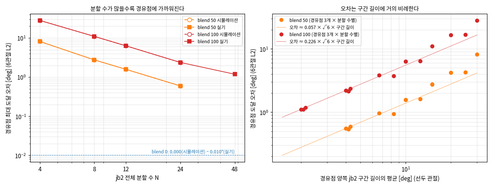
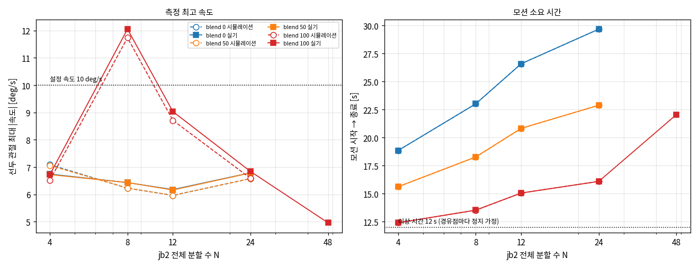
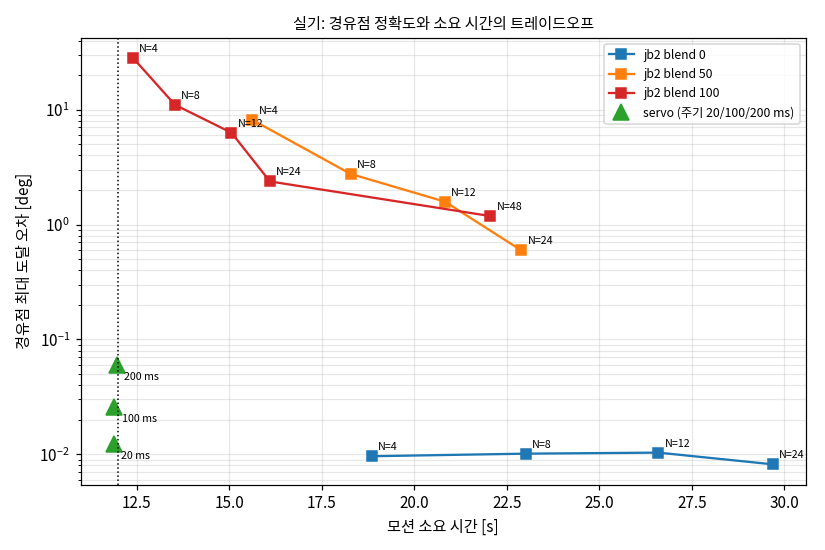
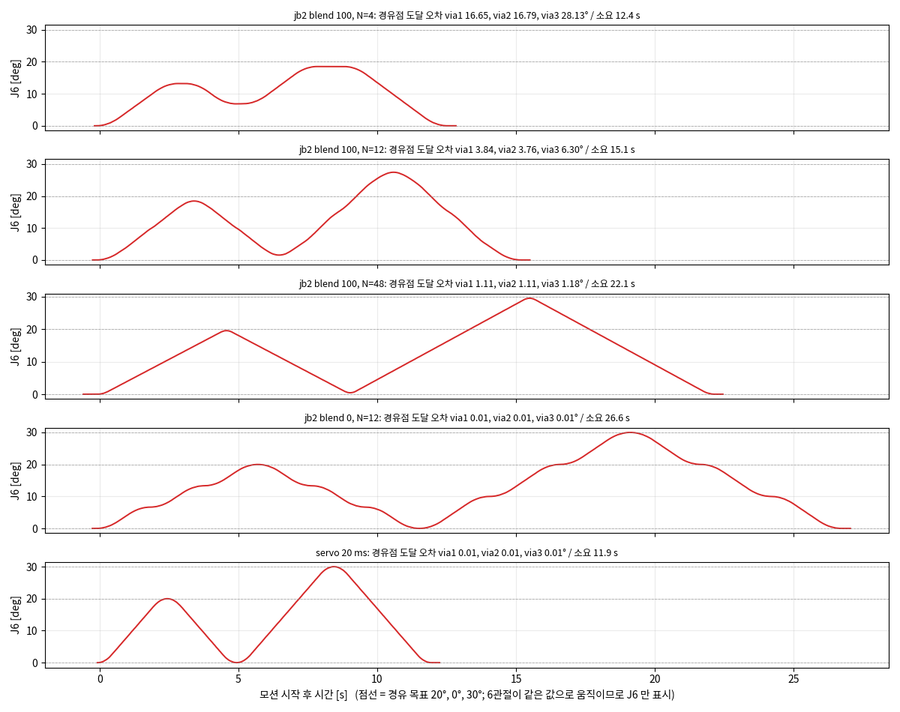

# 웨이포인트 분할에 따른 속도·경유점 도달 오차 (jb2 / servo)

- 목적: 같은 경로를 jb2 의 분할 수·blend 와 servo 의 전송 주기를 바꿔 실행하고, **속도**와 **경유점에 얼마나 가깝게 도달했는지** 비교
- 실험 시각: 2026-10-16 15:22 ~ 15:37, 도구: `rb_servo_test/jb2_gui`, 로봇 IP 10.0.2.7
- 대상: 분석 28건 (jb2 시뮬레이션 12, jb2 실기 13, servo 실기 3), 제외 1건
- 수치는 모두 `runs_summary.csv` 에 있음 (실행 폴더별 원시 값은 `out/<폴더>/waypoint_proximity_0.csv`)

---

## 요약

| 명령 | 경유점 도달 오차 (최대, 실기) | 모션 시간 (이상 12 s) | 측정 최고 속도 (설정 10) |
|---|---|---|---|
| jb2 blend 0 | 0.008 ~ 0.010° (분할 수와 무관) | 18.9 ~ 29.7 s (분할 수↑ → 느림) | 6.2 ~ 6.8 |
| jb2 blend 50 | 8.15° (N=4) → 0.60° (N=24) | 15.6 → 22.9 s | 6.2 ~ 6.8 |
| jb2 blend 100 | 28.1° (N=4) → 1.18° (N=48) | 12.4 → 22.1 s | 5.0 ~ **12.1** |
| servo (gain 1) | 0.012 ~ 0.060° (주기 20 → 200 ms) | 11.9 ~ 12.0 s | 10.5 ~ 10.7 |

- **blend 0**: 모든 경유점에 정확히 도달 (시뮬레이션 0.000°, 실기 0.01° 이하). 대신 점마다 정지하므로 분할 수가 늘수록 느려짐
- **blend 50·100**: 코너를 깎아 경유점에 못 미침. **오차는 구간 길이에 거의 비례** (blend 100 은 구간 길이의 약 0.25배, blend 50 은 약 0.06배)
- 분할 수를 늘리면 오차는 줄지만 **모션 시간은 늘고 속도는 설정에 못 미침** (blend 100: N=4 12.4 s → N=48 22.1 s)
- **servo**: 경유점에 0.06° 이내로 도달하면서 시간은 이상값(12 s)과 거의 같음. 전송 주기가 길수록 오차 증가 (20 → 200 ms 에서 5배)
- 시뮬레이션과 실기의 도달 오차 차이는 최대 0.007° → 경유점 도달은 제어기 계획이 결정함

---

## 1. 실험 조건

- 경로: 6관절이 같은 값으로 움직이는 왕복 `0 → 20 → 0 → 30 → 0` (deg), 시작 자세 `0 0 0 0 0 0`
  - 웨이포인트 5개: start, via1 (20°), via2 (0°, 반전), via3 (30°), end (0°)
  - 구간(leg) 4개: 최대 이동 20°, 20°, 30°, 30°
- 공통 설정: speed 10 deg/s, accel 20 deg/s², speed bar 1.0, 기록 100 Hz, 속도 차분 창 0.1 s
- 이상 모션 시간 12 s: 경유점마다 정지하는 사다리꼴 프로파일 (`vp = min(speed, √(accel × 구간 길이))`)의 합

| 명령 | 변경한 항목 | 값 |
|---|---|---|
| jb2 (`move_jb2_add` → `move_jb2_run`) | 전체 분할 수 N | 4, 8, 12, 24 (실기 blend 100 은 48 추가) |
| | blend | 0, 50, 100 |
| servo (`move_servo_j`) | 전송 주기 | 20, 100, 200 ms (gain 1, alpha 1, t2 0.1 s) |

- 분할 수 N 은 **경로 전체**의 jb2 구간 수이며 leg 길이에 비례해 나눔 (각 leg 최소 1개)

| N | leg 별 분할 수 (20°, 20°, 30°, 30°) | jb2 구간 길이 [deg] (선두 관절) |
|---|---|---|
| 4 | [1, 1, 1, 1] | 20.00, 20.00, 30.00, 30.00 |
| 8 | [2, 2, 2, 2] | 10.00, 10.00, 15.00, 15.00 |
| 12 | [3, 3, 3, 3] | 6.67, 6.67, 10.00, 10.00 |
| 24 | [5, 5, 7, 7] | 4.00, 4.00, 4.29, 4.29 |
| 48 | [10, 10, 14, 14] | 2.00, 2.00, 2.14, 2.14 |

- N=4 는 jb2 에 보낸 점이 경유점·목표 4개뿐임 (중간 점 없음)
- 시뮬레이션 jb2: 12건 (N 4/8/12/24 × blend 0/50/100), 실기 jb2: 13건 (같은 조합 + N=48 blend 100), 실기 servo: 3건
- 제외: servo gain 0.1 (사용자 중지로 미완료) 1건

---

## 2. 평가 지표

- **경유점 도달 오차**: 실측 경로(100 Hz 샘플 사이를 선분으로 이은 꺾은선)와 웨이포인트의 **6관절 공간 최단 거리** (deg, L2)
  - 시간은 보지 않음 (timing 이 달라도 경로가 그 점을 지났는지만 평가)
  - 웨이포인트를 지정한 순서대로 지나는 것으로 배정 (시작=목표인 왕복도 구분)
  - 본 보고서의 값은 "경유점 3개 중 최댓값"이며, 개별 값은 CSV 의 via1/via2/via3
- **측정 최고 속도**: 선두 관절의 최대 |속도| (0.1 s 중심 차분)
- **모션 소요 시간**: 시작 자세에서 벗어난 시각 ~ 최종 자세의 0.05° 이내에 계속 머무는 시각
- 같은 조건 1회씩 실행 (반복 없음)

---

## 3. 결과

### 3.1 jb2: 분할 수와 경유점 도달 오차

경유점 최대 도달 오차 [deg] (시뮬레이션 / 실기)

| 분할 수 N | blend 0 | blend 50 | blend 100 |
|---|---|---|---|
| 4 | 0.000 / 0.010 | 8.150 / 8.153 | 28.124 / 28.130 |
| 8 | 0.000 / 0.010 | 2.753 / 2.759 | 11.013 / 11.017 |
| 12 | 0.000 / 0.010 | 1.574 / 1.579 | 6.295 / 6.300 |
| 24 | 0.000 / 0.008 | 0.593 / 0.595 | 2.371 / 2.373 |
| 48 | - / - | - / - | - / 1.185 |

경유점별 오차 (실기, blend 100) [deg]

| N | via1 (20°) | via2 (0°, 반전) | via3 (30°) | 보낸 분할점 평균 / 최대 |
|---|---|---|---|---|
| 4 | 16.65 | 16.79 | 28.13 | 15.40 / 28.13 |
| 8 | 6.30 | 6.44 | 11.02 | 2.98 / 11.02 |
| 12 | 3.84 | 3.76 | 6.30 | 1.17 / 6.30 |
| 24 | 2.21 | 2.15 | 2.37 | 0.29 / 2.37 |
| 48 | 1.11 | 1.11 | 1.18 | 0.08 / 1.18 |
| 48 | 1.11 | 1.11 | 1.18 | 0.08 / 1.18 |

- **blend 0**: 분할 수와 무관하게 모든 경유점에 정확히 도달 (시뮬레이션 0.000°, 실기 0.008 ~ 0.010° = 엔코더 측정 수준)
- **blend 50**: N=4 8.15° → N=24 0.60°
- **blend 100**: N=4 28.1° → N=24 2.37° → N=48 1.18°
- 오차가 가장 큰 경유점은 via3 (30° 정점). 이동량이 큰 구간(30°)에서 코너 절삭이 큼
- **오차와 구간 길이의 관계**: 경유점 양쪽 jb2 구간 길이의 평균 ℓ 에 대해 오차 / (ℓ × √6) 비율 (√6 = 6관절이 같은 값으로 움직일 때 L2 환산)

| 구간 길이 ℓ | blend 50 비율 (평균, 범위, n) | blend 100 비율 (평균, 범위, n) |
|---|---|---|
| 0 ~ 5° | 0.055 (0.053 ~ 0.057, 6) | 0.222 (0.212 ~ 0.226, 9) |
| 5 ~ 12° | 0.058 (0.046 ~ 0.065, 8) | 0.233 (0.184 ~ 0.257, 8) |
| 12 ~ 40° | 0.079 (0.053 ~ 0.111, 10) | 0.301 (0.210 ~ 0.383, 10) |

- 구간이 12° 이하이면 비율이 거의 일정: blend 50 은 약 0.05 ~ 0.07, blend 100 은 약 0.18 ~ 0.26
  - 관절당 환산: 경유점에서 **각 관절이 목표에서 벗어나는 양 ≈ ℓ × (blend 50: 0.06, blend 100: 0.23)** (6관절 같은 이동량, speed 10 기준)
- 구간이 12° 를 넘으면 비율이 더 큼 (평균 blend 50 0.079, blend 100 0.301; 표 참고)
- 같은 경로에서 얻은 경험식이므로 속도·자세·이동량 비율이 다른 경로에는 그대로 적용하지 말고 확인해야 함

### 3.2 jb2: 속도와 소요 시간

측정 최고 속도 [deg/s] (시뮬레이션 / 실기, 설정 10)

| 분할 수 N | blend 0 | blend 50 | blend 100 |
|---|---|---|---|
| 4 | 7.1 / 6.7 | 7.1 / 6.7 | 6.5 / 6.7 |
| 8 | 6.2 / 6.4 | 6.2 / 6.4 | 11.7 / 12.1 |
| 12 | 6.0 / 6.2 | 6.0 / 6.2 | 8.7 / 9.0 |
| 24 | 6.6 / 6.8 | 6.6 / 6.8 | 6.6 / 6.8 |
| 48 | - / - | - / - | - / 5.0 |
| 48 | - | - | - / 5.0 |

모션 소요 시간 [s] (시뮬레이션 / 실기, 이상 12.0 s)

| 분할 수 N | blend 0 | blend 50 | blend 100 |
|---|---|---|---|
| 4 | 18.9 / 18.9 | 15.6 / 15.6 | 12.4 / 12.4 |
| 8 | 23.0 / 23.0 | 18.3 / 18.3 | 13.5 / 13.5 |
| 12 | 26.6 / 26.6 | 20.8 / 20.8 | 15.1 / 15.1 |
| 24 | 29.7 / 29.7 | 22.9 / 22.9 | 16.1 / 16.1 |
| 48 | - / - | - / - | - / 22.1 |
| 48 | - | - | - / 22.1 |

- 대부분 **설정 속도 10 에 못 미침** (5.0 ~ 7.1). 구간이 짧으면 속도를 올릴 거리가 부족하기 때문 (`vp ≈ √(accel × 구간 길이)`)
- **blend 100, N=8 에서만 설정 속도 초과**: 시뮬레이션 11.7, 실기 12.1 (설정의 1.21배), N=12 는 9.0. 코너를 가로지르며 속도가 올라간 것으로 보이며 원인은 확인하지 못함
- **blend 0**: 점마다 정지해 시간이 길고 분할 수가 늘수록 더 길어짐 (N=4 18.9 s → N=24 29.7 s, N이 6배일 때 시간은 약 1.6배)
- **blend 100**: 이상 시간(12 s)에 가장 가까움 (N=4 12.4 s) 하지만 분할 수를 늘릴수록 길어짐 (N=48 22.1 s)

### 3.3 servo: 전송 주기와 경유점 도달 오차

| 설정 주기 | 실제 전송 간격 평균 ± 표준편차 [ms] (최소 ~ 최대) | 계획 대비 늦음 평균 / 최대 [ms] | 경유점 최대 오차 [deg] | via1 / via2 / via3 [deg] | 측정 최고 속도 | 모션 시간 [s] |
|---|---|---|---|---|---|---|
| 20 ms | 20.00 ± 0.04 (19.5 ~ 20.5) | 0.16 / 0.70 | 0.012 | 0.012 / 0.010 / 0.012 | 10.7 | 11.88 |
| 100 ms | 100.00 ± 0.03 (99.9 ~ 100.1) | 0.16 / 0.20 | 0.026 | 0.026 / 0.023 / 0.024 | 10.7 | 11.90 |
| 200 ms | 193.54 ± 1.05 (192.2 ~ 194.5) | 0.16 / 0.20 | 0.060 | 0.055 / 0.060 / 0.059 | 10.5 | 11.96 |

- **전송 주기의 정확도**: PC 에서 `move_servo_j` 를 보낸 시각 기준으로 계획 간격과 거의 같음 (20 ms, 100 ms 는 표준편차 0.03 ~ 0.04 ms, 계획 대비 늦음 최대 0.7 ms)
- **설정 200 ms 는 실제로 평균 193.5 ms**: 모션 시간 12 s 를 설정 주기 이하의 같은 간격으로 나누므로 (`ceil(12 / 0.2) = 62`개) 설정값은 주기의 상한임. 이 표의 "200 ms"는 실제 193.5 ms
- 측정한 것은 **PC 가 보낸 시각**임. 제어기가 명령을 받아 처리한 시각(네트워크·버퍼 지연)은 측정하지 못했음
- 지터 최대 0.7 ms 는 20 ms 주기의 3.5 %, t2 (0.1 s) 에 비해 작음. 다만 일반 Linux 라 드물게 큰 지연이 생길 수 있고, 본 실험 600회에서는 관측되지 않음

- 모두 0.06° 이내로 경유점에 도달하고 모션 시간은 이상값 12 s 와 거의 같음 (11.9 ~ 12.0 s)
- 전송 주기가 길수록 오차가 커짐 (20 ms 0.012° → 설정 200 ms(실제 193.5 ms) 0.060°, 5배)
- 측정 최고 속도는 10.5 ~ 10.7 로 설정의 1.05 ~ 1.07배
- servo 는 시뮬레이션 실행이 없고, gain 0.1 실행은 중단되어 gain 의 영향은 확인하지 못함

- servo 는 경로 전체를 하나의 시간 프로파일로 보내므로 jb2 와 달리 분할 수·blend 개념이 없음

### 3.4 트레이드오프

- jb2 는 **blend 0 (정확하지만 느림) ↔ blend 100 (빠르지만 코너를 깎음)** 사이에서 선택하고, 분할 수로 정확도를 사 오면 시간이 늘어남
- servo 는 0.06° 이하의 도달 오차와 이상 시간에 가까운 시간을 동시에 만족
- 각 실행의 궤적 예 (J6):

---

## 4. 결론과 권장

1. **경유점을 정확히 지나야 하면 jb2 blend 0 또는 servo**: 0.01 ~ 0.06° 이내 (jb2 blend 0 은 느림, servo 는 주기 20 ms 권장)
2. **jb2 blend 50·100 은 코너 절삭이 있음**: 오차 ≈ 구간 길이 × 계수 (blend 50 약 0.06, blend 100 약 0.23, 관절당)
   - 허용 오차 e [deg/관절] 를 정하면 구간 길이 ≈ e / 계수 이하로 분할 (예: blend 100 에서 관절당 0.5° 이내이면 구간 약 2° 이하)
   - 분할 수가 늘수록 시간이 늘고 속도가 낮아지므로, 정확도와 시간 사이에서 정함
3. **jb2 blend 100 은 일부 분할 수에서 설정 속도를 초과**할 수 있음 (N=8 에서 1.2배). 속도 제한이 중요하면 실측으로 확인
4. **시뮬레이션으로 사전 선정 가능**: 경유점 도달 오차 차이 최대 0.007° (jb2)

---

## 5. 한계

- 경로 1종 (6관절 같은 값으로 움직이는 왕복, 이동량 20°·30°), 속도 10 deg/s, 가속도 20 deg/s² 한 조건. 속도·가속도·관절 구성이 다르면 계수와 속도 거동이 달라질 수 있음
- 조건마다 1회 실행 (반복 오차 미확인). 단, 시뮬레이션과 실기가 같은 값을 줘 재현성은 높아 보임
- servo 는 실기 3건만 (시뮬레이션 없음, gain·alpha 변화 없음, 분할 개념 없음)
- 오차 계수(blend 별 비율)는 이 경로에서 얻은 경험값이며 제어기 내부 blending 식은 확인하지 못함
- 이상 시간 12 s 는 경유점마다 정지하는 프로파일의 합으로, blend 가 있는 제어기 동작의 예측값이 아님
- 6관절이 같은 값으로 움직이는 경로라 관절마다 속도·가속도 한계가 다른 효과(이전 단일 관절 실험)는 이 경로에서 분리되지 않음

---

## 부록. 파일

| 파일 | 내용 |
|---|---|
| `runs_summary.csv` | 실행별 조건, 경유점 오차, 속도, 시간 (분석 29건 중 완료 28건) |
| `out/20261016_152212_* ~ 153709_*/` | 원본 실행 폴더 (`waypoint_proximity_0.csv`, `command_points_proximity_0.csv`, `velocity_0.csv`, `summary.csv`) |
| `report/make_report.py`, `collect.py` | 이 보고서의 표·그림 생성 |